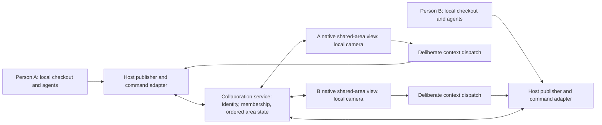

# Collaboration implementation plan

29 October 2026. **Implementation now authorized and started.** See [progress](PROGRESS.md) and [decisions](DECISIONS.md). The following describes the original planning baseline: This continues the initial research and incorporates twelve additional implementation studies, bringing the conversation's research total to twenty-four agents. Creating planning tickets is authorized; executing those tickets, changing product code and deploying services are outside this task.

## Feasibility

**A useful version is technically feasible, but multi-human collaboration is a substantial new subsystem.** Existing Array code supplies native selection/geometry, strict runner ownership, transcript snapshot/tail observation, prepared prompt submission, a SQLite/NIO relay and Linux service packaging. It does not already supply multi-person identity, shared-area membership, portable collaborative documents, complete artifact sharing or correct per-person usage accounting.

The first usable milestone is a complete two-person shared work area, not a session-only link. Both people keep their own code checkouts and agents, share selected work and a common arrangement, discuss decisions, maintain a revisioned agreement, and explicitly send context to their own agents. Presence and live usage on hover are included.

Source-grounded details are in the [twelve implementation memos](implementation/README.md). Source inspection is feasibility evidence, not runtime verification or an estimate.

## Recommended decisions, with explicit gates

| Topic | Planning recommendation | Gate before implementation relies on it |
| --- | --- | --- |
| Client | Native Mac-to-Mac first; keep protocol client-neutral | Prove the same scene/view ownership on two isolated native clients |
| Shared object | One portable `SharedAreaDocument` behind workspace, zone and capture entry points | Approve domain/UX contract without importing local workspace/agent records |
| Layout | Joint arrangement in area-local coordinates, personal cameras and local placement | Prototype mounted ownership/coordinate path; no writes to source project geometry |
| Capture | Explicit reviewed membership and preserved model layout | Cover persisted/unhydrated members; enumerate unsupported tile capabilities |
| Authority | Person, device, host, membership and object capabilities separately | Prove third-person exclusion and revocation in server and host paths |
| Synchronization | Authenticated server-ordered typed operations, snapshots and explicit conflicts | Crash/replay/compaction witnesses; no whole-document last-writer overwrite |
| Discussion/context | Ordered human messages; immutable agreement revisions; deliberate dispatch | Concurrent edit conflicts retain drafts; per-agent receipt identifies actual revision |
| Execution | One host owns each runner; remote references are view-only by default | Mount/reconnect cannot mint a second executor; dispatch rechecks live authority |
| Usage | Normalize actual provider reports into a durable ledger | Replay/cumulative/cache/subagent fixtures pass before showing teammate totals |
| Files | Selected immutable artifacts for review; no automatic checkout synchronization | Snapshot identifies actual base/content and excludes unselected bytes |
| Hosting | Extend existing relay plumbing with separate collaboration scope/routes/store | Compatibility, isolated staging, backup/restore and measured operating limits |
| Confidentiality | Decide explicitly before publishing real content | Trusted-relay handling versus real multi-human E2EE is a blocking architecture decision |

For the fastest credible coworker alpha, the security/transport studies recommend a trusted collaboration service, TLS, explicit storage/key/retention policy and honest disclosure that the service can read new shared content. **This is not an adopted confidentiality policy.** Existing companion transcript encryption remains unchanged. If relay-blind content is required, group device keys, admission, epochs, rotation, history and recovery become blocking work; expand the backlog before proceeding. Paired-device encryption cannot be renamed into group E2EE.

No library or dependency is selected here. Yjs documents concurrent shared types and network-independent updates, but its editor/runtime integration is additional work in native Swift. A text CRDT may be appropriate if character-level simultaneous/offline editing is required; it does not solve permissions or execution. [Yjs official docs](https://docs.yjs.dev/). The existing relay already uses SwiftNIO, whose official repository documents the networking framework. [SwiftNIO](https://github.com/apple/swift-nio). Neither source establishes Array capacity or end-to-end behavior.

## Architecture and ownership

Separate lanes:

1. **Durable shared state:** area membership, object admission, layout operations, discussion, immutable context revisions and pinned artifact references.
2. **Owner-published observations:** permitted agent snapshots/tails, current capabilities, source generation, usage summaries and artifact latest pointers.
3. **Ephemeral presence:** area-local cursors, selected-object attention, follow viewport and liveness. Coalesce/expire; never persist pointer history as layout.
4. **Host actions:** authorized explicit context/prompt requests with stable command identity, current permission checks and durable outcome records.
5. **Private local state:** code checkout, runner process, CLI login, source project canvas, outer placement, camera, focus, armed creation scope and drafts.

One source object can appear in multiple shared areas through references. Closing a remote view only removes a subscription; it cannot stop the source runner. Area geometry cannot be written through a source project's persistence path. A shared area should have one geometry authority, not a new owner competing with existing zone chrome.

## First complete workflow

1. Select a workspace, zone or captured region; review exact supported objects and publication modes.
2. Invite a colleague into one shared area. Both retain private surrounding work.
3. Both see the same internal layout, with independent cameras. Each can publish a relevant locally owned agent.
4. Discuss ideas and agree on a brief/boundary revision. Human messages remain human unless explicitly dispatched.
5. Each person sends the reviewed revision to a chosen own agent through normal host prompt preparation. Teammate suggestions can be accepted by the owner; direct teammate control is a separate grant.
6. Show per-agent requested/accepted/queued/submission-observed/unknown states and changed-since-sent context truthfully.
7. Share selected version-pinned diffs/files/results for discussion. The receiver's checkout stays unchanged.
8. Show collaborator cursors and optional following; hover/focus reveals freshest reported token usage, period/scope/coverage and agent state. No permanent token overlay.
9. Reopen discussion/agreements after a laptop sleeps; show cached artifact availability and host availability separately.

Supporting all three share actions means one membership/manifest pipeline with three enumeration scopes. It does not imply every existing tile kind supports complete live sharing. Unsupported terminal/browser/other objects must be explicitly named or excluded, never silently materialized as empty local copies.

## Source discoveries that determine scope

- `Registry` enforces exclusive local project/workspace ownership; `Tile.zoneId` has one owner. Shared references cannot reparent original tiles to represent collaboration.
- Existing spatial sync has deterministic LWW/tombstone machinery, but source documents memory-only storage and missing production canvas wiring; its resolver omits ambient tiles. It is a source of invariants, not a ready shared workspace.
- `RelayStore` schema is instance/device scoped, roles are desktop/companion, and command receipt is not host execution acknowledgment. New human identity and area authorization are critical path.
- Existing relay bootstrap/tail limits require complete paged replay tests, including more than 500 events. A bounded tail cannot silently become an incomplete shared state.
- Supervisor snapshot+tail is a practical live-view seam. Exported events still need allowlisting, stable sequence/generation and authenticated provenance.
- Production runner refinements support selected steering/interrupt behavior, but no inspected production `AgentRequestResponding` conformer establishes generic remote approval support. Codex currently configures approval policy `never`. Do not advertise universal approvals.
- Claude usage includes run aggregates, Codex app-server totals are cumulative, and Pi reports message counters with cache distinctions. Existing `TokenUsageSnapshot` lacks durable accounting identity/scope. Summing UI snapshots would be incorrect.
- Existing diff producers do not capture every worktree state: tracked working changes, branch comparison and untracked files have different coverage. New immutable capture must say precisely what it includes.
- A local browser URL does not share reachability, authentication or cookies. Start with explicit snapshots/reachable links; live previews require a separately designed channel.

See each memo for actual source paths, uncertainty and candidate witnesses. Historical relay designs contain broader membership ideas than current code implements; do not use history as completion evidence.

## Delivery phases and dependency order

| Phase | Tickets | Exit condition |
| --- | --- | --- |
| 0 — Settle contracts and make failures testable | COL-01–02 | Explicit domain/layout/identity/confidentiality decisions and a production-service multi-principal harness foundation |
| 1 — Make a real shared area durable and scoped | COL-03–08 | Two people, one area, private third principal, durable state/cache, live revoke and truthful source binding |
| 2 — Make the spatial coordination workflow usable | COL-09–16 | Workspace/zone/capture, mounted shared layout, discussion/agreement, deliberate delivery, live agents and pinned artifacts |
| 3 — Add awareness and prove recovery | COL-17–20 | Accurate freshest-reported hover usage, contextual presence/follow, replay/restore and negative boundary cases |
| 4 — Establish the coworker-alpha gate | COL-21–22 | Matrix reports production-path witnesses; native appearance/performance/accessibility and isolated operational restore evidence |
| Later scoped additions | COL-23–26 | Explicit code import, browser participation, live previews and richer control are separately evaluated and gated |

Phases describe coherent outcomes rather than rigid serial staffing. For example, usage adapter work can begin against the agreed event contract before native mounting finishes. Do not call a pile of isolated subsystem checks a completed collaboration milestone.

Critical path: **contracts → person/membership + area service → authorized publications and local bindings → mounted shared area + revisioned context → end-to-end dispatch/recovery → alpha evidence**. Usage, immutable artifact production and native interaction can proceed in parallel once their contracts are stable. Do not begin group encryption, offline text CRDT, browser client or universal remote terminal work merely because those are technically possible.

## Acceptance and release boundary

Use three independent principals: A and B invited, C excluded. Each host uses its own temporary project root, app-support directory, defaults suite and provider transport fixture. Test real service routes and the production workspace mount/host dispatch, not only a pure reducer or checks-only installer.

Required fault schedules include simultaneous layout edits; concurrent agreement edits; lost replies; host crash around provider submission; over-500-event reconnect; snapshot compaction; old-generation replay; removal during drag/hover/queued input; unsupported schema; and source code changing during review.

Acceptance is not execution completion. For an ambiguous provider submission, retain **outcome unknown** and reconcile original evidence; never repair by blindly resending under a new ID. True exactly-once external side effects cannot be promised from relay idempotency alone.

Verify exact visible world frames, original source-state bytes, actual runner counts, delivered payload exclusions, provider-normalized usage values and UI disappearance on hover exit. Count-based performance gates should ensure presence causes no content measurement or canvas saves. Inspect real native light/dark, accessibility, Reduce Motion and keyboard paths before previewing.

New behavioral witnesses must be introduced, registered and visibly reported by `scripts/run-matrix.sh`; proposed check names are not existing commands. Preserve known-red reporting and existing companion/scene/camera gates. Update notification path IDs only when implementing actual invitation/activity notifications; no notification behavior is added now.

No effort dates or hosting price are estimated from source inspection. Estimate after COL-01/02 resolve architecture and expose a tested path through the service and scene. Any deployment, migrations or external sharing would be a separate reviewable implementation/release action.

## Board and handoff

All planned cards belong in the previously empty **Array feats** board directly above the requesting agent:

- Board ID: `F54D4170-AB61-4595-A4D4-A400B76364A5`.
- Board tile ID: `CA73963B-1486-413C-9913-7B336742354D`.
- Initial revision: `0`, all three columns empty.
- Destination: existing **To Do**, `01DE61A9-AECF-4EB1-91BE-EF1242EB3CAF`.
- The other board, `B551E866-A411-489E-AA66-56B32D5841A6`, had 17 cards and is excluded from writes.

[Ticket catalogue](TICKETS.md) is the detailed local handoff; [board receipt](BOARD-RECEIPT.json) records the actual created card identities after API verification. All tickets remain unassigned and unstarted. Reading or creating a card does not start an agent task.
