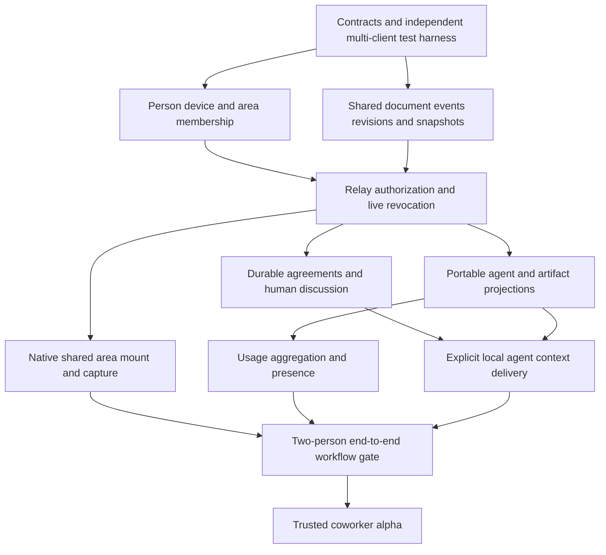

# Delivery feasibility and independent critique

29 October 2026. Implementation planning only. Recommendations below are not implementation approval, tested behavior, an estimate or a release promise. Only this memo was written; no product code, live workspace state or Git history was changed.

## Feasibility judgment

**A useful version is technically feasible with Array's current native app and relay stack, but human collaboration is a substantial new subsystem.** The existing infrastructure reduces groundwork around transport, SQLite persistence, agent observation, native canvas composition and steering. It does not supply multi-human identity, shared-area membership or a durable collaborative document as an already working feature.

The recurring job is two developers coordinating distinct agents and code ownership. A coherent first release must therefore let two people share an area of useful work, discuss it and send selected agreements to their own agents. One owner-hosted session link is not a sufficient milestone for this request.

## Source evidence affecting delivery

| Current evidence | Consequence |
| --- | --- |
| `Sources/ContinuumRevivedRelayProtocol/RelayProtocol.swift:17` defines only desktop/companion credential roles. | A teammate is not another paired personal companion; add a multi-human authority model before real invitations. |
| `Sources/ContinuumRevivedRelayCore/RelayStore.swift` stores instances, credentials, ordered events and idempotent commands scoped to an instance. | Reuse database/transport patterns, but design collaboration area membership and isolation explicitly. |
| `Sources/ContinuumRevivedRelayNIO/RelayServer.swift` hosts HTTP/WebSocket traffic and bounded requests. `RelayPackage.swift` packages relay/core/integration checks for Linux. | An owned, always-on relay is a plausible first hosting strategy; a new hosting vendor is not inherently required. Existing deployment capacity and operational budget still need confirmation. |
| `Sources/ContinuumRevivedCore/Agents/AgentRecord.swift:7` separates the agent from its tile, while lines 19 onward prohibit exporting the host-bound record. | Remote views can reference one execution owner, but need a purpose-built portable projection. |
| `Sources/ContinuumRevived/App/AgentSupervisor.swift:142` defines steering, with Claude/Codex/PiRPC production conformers. Request-response is a separate refinement at line 182. | Selected context delivery and visible queuing can build on real runner seams. Do not promise remote approval parity merely because the refinement exists. |
| `Sources/ContinuumRevivedCore/AgentProviders/CodexAgentRunner.swift` sets `approval_policy=never`; provider response support is not established for every production runner. | First release authority must be described in terms of actual configured behavior, rather than an imagined universal approval dialog. |
| `Sources/ContinuumRevived/Canvas/CanvasTileSelection.swift` and `docs/internals/tile-multiselect.md` preserve relative geometry and origin ownership. | Structured capture can reuse the selection concept, but must not turn captured source tiles into a different project's persisted owners. |
| `Sources/ContinuumRevivedCore/AgentProviders/PiEventTranslator.swift:523` emits usage, deduplicates signatures and exposes cache categories separately. | Usage reporting exists, but cross-provider aggregation and live freshness are separate work; a live connection does not guarantee per-token streaming counters. |
| `scripts/run-matrix.sh` already builds relay integration products and reports all legs. | Reuse the maintained gate, adding production-path multi-client witnesses rather than a separate unreported test island. |
| `docs/38-tickets/92-small-team-relay/_DESIGN.md` describes workspace membership and has a stopped historical implementation status. | Treat this as historical design intent, not evidence the named system exists. The current request authorizes planning, not resuming that entire historical program. |

## Recommended first usable vertical slice

**Two invited people, native Array clients, one durable shared area, separate local checkouts and separately owned agents.**

The slice should include:

1. Capture selected tiles and their relative layout, or choose a zone/workspace as the initial selection scope; review explicit included objects before publishing.
2. Invite one other person to that shared area with durable membership, explicit capabilities and revocation.
3. Mount the shared internal arrangement inside each person's local workspace, with personal cameras and an explicit local anchor. Preserve source project/agent ownership.
4. Keep a durable shared brief/agreement and human discussion together. Use immutable submitted revisions and explicit edit conflicts before pursuing sophisticated simultaneous text merging.
5. Display both people's selected agent activity/transcript projections without duplicating either executor. Each person can run their own agent against their own checkout.
6. Deliberately dispatch an identified agreement/prompt revision to the chosen locally owned agent; show accepted/queued/failed state and changed-since-sent information truthfully.
7. Share cursor/selection presence and expose freshest available teammate usage on cursor/avatar hover, with no always-on usage overlay. Include partial/stale coverage states.
8. Attach a selected revision-pinned diff or other review artifact, so discussion can reference what actually changed. Showing a remote revision must not imply the recipient's checkout contains it.
9. Restore shared discussion/agreements after either client reconnects. When an execution host is absent, distinguish cached content from live availability.

This is intentionally a whole workflow, not a claim that every feature should be built simultaneously. Subsystem work can land behind an inert development gate; the milestone only becomes usable when these parts work together.

“Share workspace” should initially mean sharing a reviewed set of supported objects and its arrangement, not instant compatibility with every existing tile kind. Unsupported terminals/browser sessions need explicit placeholders or exclusions, not silently fake copies. All three entry actions—workspace, zone, capture—should converge on the same area/membership model rather than three separate sync products.

## Dependency graph

The graph expresses required correctness dependencies. It does not prescribe branches, agent staffing or a release date. Foundational design work can proceed in parallel; end-to-end delivery must wait for authorization and persistence semantics.

## Gates before widening scope

| Gate | Required observed result | Do not infer |
| --- | --- | --- |
| Domain/crypto contract | Two independent principals share one area while a third principal cannot access it; chosen content encryption, key distribution/revocation and server-visible metadata are explicitly documented. | Existing paired-device crypto automatically supports multiple humans. |
| Persistence/reconnect | Two local clients converge on accepted document events after disconnect; editing the same brief detects conflict; a dispatched request is not replayed twice. | LWW geometry is sufficient for prose, prompts and execution. |
| Capture/mount | Relative geometry persists across reopen and local anchors; source files, tile origin ownership and original agent count remain unchanged. | A shared visual zone can simply be persisted as another project's local ZoneLayer. |
| Runner delivery | Selected revision reaches exactly one intended bound runner once, with a real receipt/state transition and honest unsupported modes. | A provider accepts arbitrary concurrent users or universal approval responses. |
| Usage | Replayed cumulative reports do not inflate totals; hover shows timestamp and missing coverage; closing hover removes the usage UI. | Every provider reports per-token live usage or totals are economically comparable. |
| Practical workflow | Two participants replace the prompt-file exchange with agreement/discussion/context delivery while using independent checkouts and correctly identifying where changes live. | More simultaneous cursors or prompts prove collaborative value. |

The content encryption/identity gate needs a concrete design decision before production data is exposed. That is an architecture dependency to resolve in the tickets, not a reason to stop the current planning work.

## Hosting and client choices

**Recommend a native Mac-to-Mac alpha first.** Both participants already use the native app, so this exercises the differentiating spatial surface without also building a browser renderer, web auth, attachment client and approval UI. Keep protocol and portable projection contracts client-neutral so browser participation remains possible.

**Recommend extending the owned relay service plumbing with collaboration-scoped storage and authorization.** SQLite/WAL plus ordered area events can support the initial small-team use case if measured. Do not reuse instance pairing credentials as teammate identity or mix collaboration payloads into the personal companion stream. Before deployment, confirm the actual operational owner, backups, restore procedure, retention, per-area quotas, rate limits, version compatibility and a disposable staging host. Hosting service changes require a separately reviewable deployment step.

Estimate resources from measured subscriptions, transcript/artifact bytes, retention, reconnect replay and concurrent active clients. No price or capacity claim can be made from source inspection alone.

**Use server-sequenced accepted changes and explicit conflicts as the first hypothesis.** It may be enough for layout, discussion append events and revisioned agreements. If the product requires character-level simultaneous editing with offline merges, evaluate a CRDT as a separately demonstrated requirement, rather than assuming the existing spatial op log solves it.

## Later phases

- **Richer multi-owner contribution:** direct authorized prompts to another person's runner, richer interruption policy, larger groups and precise operator attribution. First prove request execution/replay boundaries and actual provider capabilities.
- **Richer shared artifacts:** live file/diff projections, conflict-aware explicit patch/commit import, versioned review, carefully scoped preview forwarding. Never imply `localhost` URLs or browser credentials travel automatically.
- **Durable shared workspaces:** multiple shared areas, workspace-level membership inheritance and recovery/ownership beyond a single person's laptop. Shared membership must not expose all private work by accident.
- **Browser guest participation:** compare a view/discuss/suggest client against acquisition and maintenance costs; keep identity and permission semantics identical to native clients.
- **Optional common execution environment:** only if teams need it. This adds availability, checkout concurrency, resource administration and credential boundary questions beyond the isolated-checkout workflow.

Universal terminal sharing, remote desktop, file mirroring and cross-provider execution migration are not necessary to deliver the motivating workflow and should not silently enter its scope.

## Candidate delivery tickets

### Delivery A — Prove a two-person shared-area skeleton before feature expansion

**Outcome:** a disposable, deterministic harness drives two independent clients through an authenticated relay to create/join one area, synchronize a small arrangement plus brief/discussion, and reconnect without duplication. The production capture/mount and dispatch seams remain identifiable rather than replaced with checks-only entry points.

**Dependencies:** agreed area/principal/event model, payload confidentiality decision and explicit permission contract. This can be a spike behind a development gate; it does not authorize real user data migration.

**Acceptance:** two allowed principals converge; an unrelated third gets no payload; revocation closes subsequent reads/writes/subscriptions; retry does not duplicate events; source project state is never written by the remote projection; stale/unsupported operations are explicit. A matrix-reported behavioral witness must fail when isolation or idempotency is inverted. Use only isolated stores, ports and roots.

### Delivery B — Gate the complete coworker workflow and staged alpha

**Outcome:** a runnable release checklist exercises captured area, membership, shared agreement/discussion, two locally owned agents, identified context revisions, remote artifact inspection, cursor/hover usage, disconnect and revoke. It distinguishes code visible remotely from code integrated locally.

**Dependencies:** all vertical-slice subsystem tickets. Record deployment/staging ownership and compatibility policy before activating it for invited users.

**Acceptance:** deterministic production-path witnesses reported by the matrix, inspected native light/dark/accessibility behavior, bounded update/retention performance, two-device staging run and an explicit recovery walkthrough. Preserve prod/dev and per-project root isolation. A real pilot records whether the two people made a useful contribution with less re-packaging, without treating tokens as the success metric. No ticket is marked complete solely because documents or fakes pass.

### Delivery C — Evaluate browser participation after native workflow evidence

**Outcome:** decide whether browser guests materially reduce invitation friction and which operations they need, based on the native pilot rather than assuming parity.

**Dependencies:** client-neutral contract, proven native workflow and clear trust boundary.

**Acceptance:** compare view/discuss/suggest requirements, account/admission flow, geometry/rendering scope, usage hover equivalent, attachments, revocation and host-offline behavior; produce an implement-or-defer decision with testable scope. Do not build a second full canvas or universal remote shell without a specific validated need.

## Remaining uncertainty

No implementation or tests were run for this memo. Existing working-tree code may differ from an installed release. Biggest unknowns are multi-human identity/bootstrap, content key membership and revocation, native shared-area mounting without project corruption, trustworthy cumulative token aggregation, and provider-specific accepted input attribution. Those are feasible engineering problems, but deserve early, isolated evidence before promising the complete experience.
