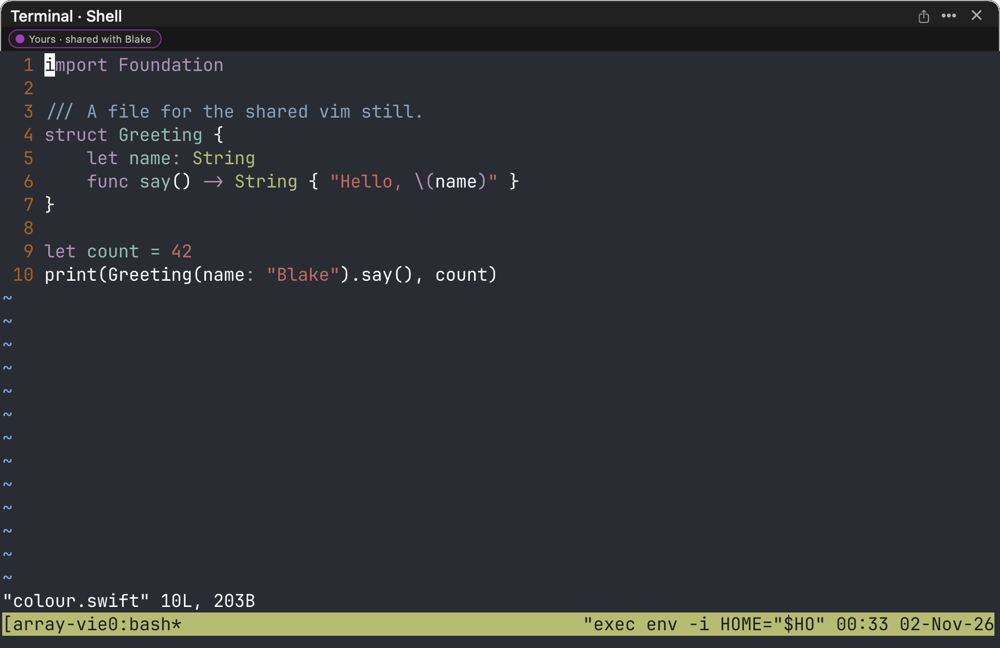
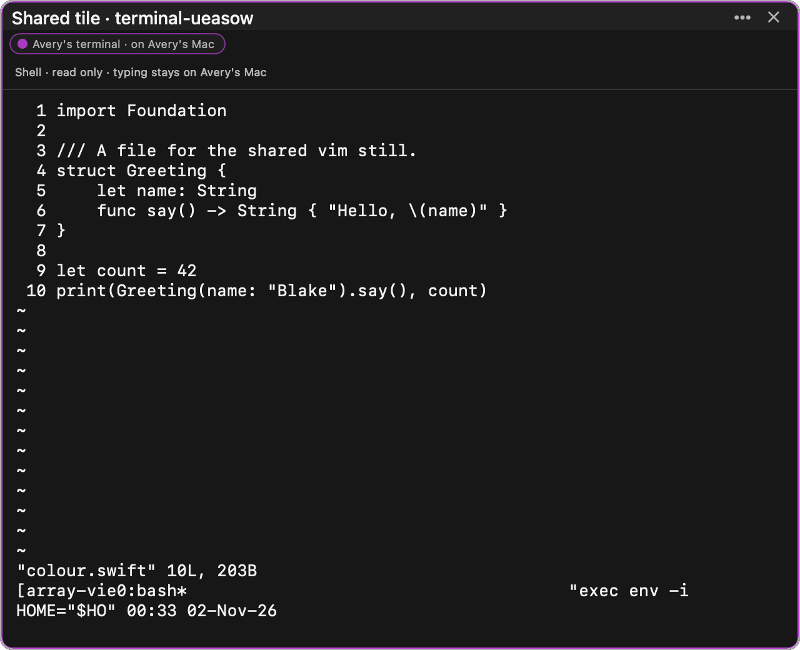
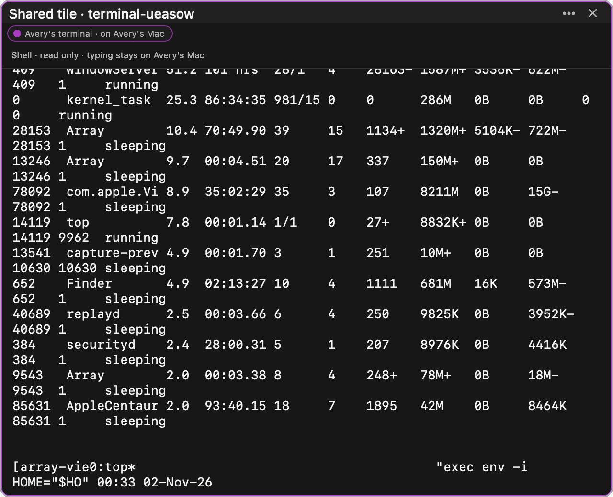
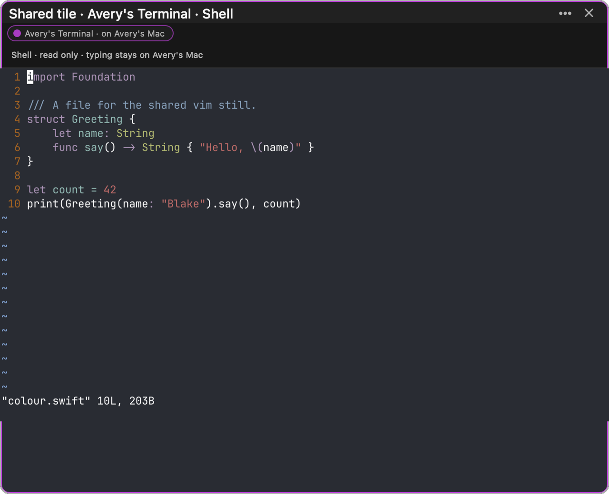
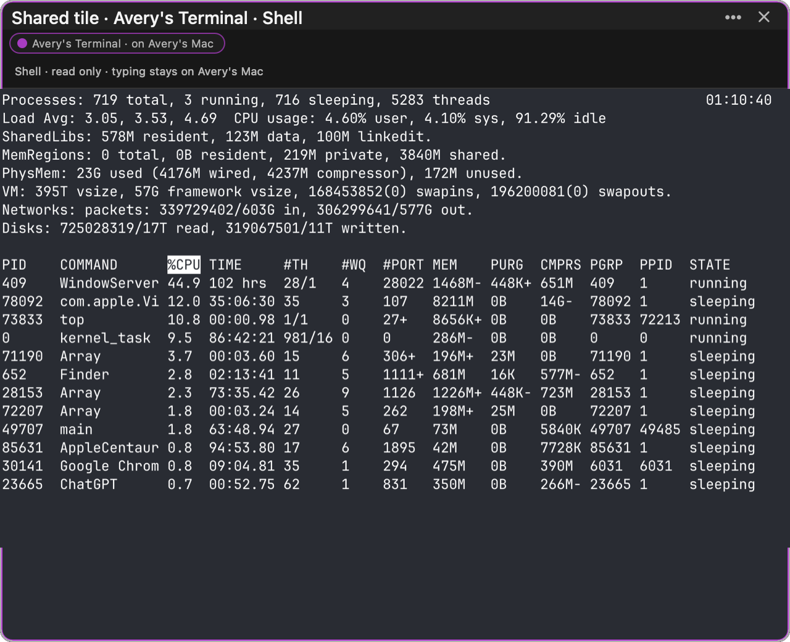
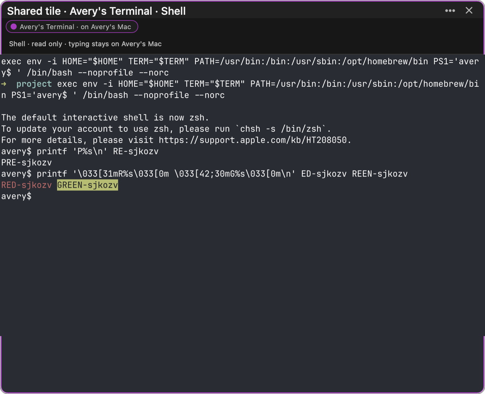
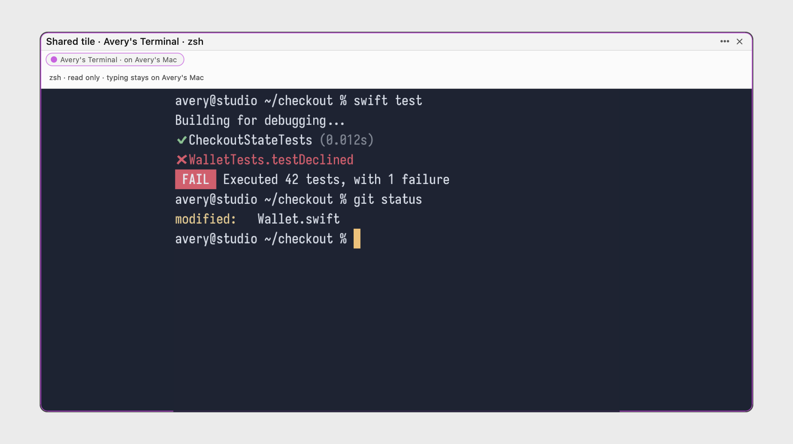
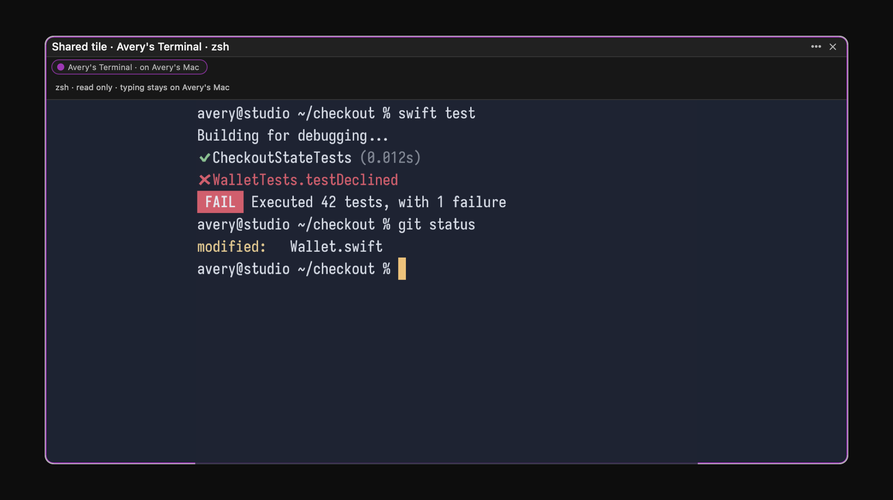

# Terminal sharing: the host's terminal, drawn on the guest's Mac

Measured 2 November 2026 on `array/terminal-sharing` (from `array/preview-0739`
at `4e277e2e`). Dylan's ask: "terminals can be shared … Dylan's Terminal and
see logs … ppl have their respective configs".

The idea: **the guest never runs anything, so the guest's configs never
matter.** The host's shell, prompt, aliases and environment produce the output
on the host's Mac. What travels is that output, the bytes the program wrote,
and the guest's Mac only draws them, with the host's colours at the host's
grid.

## 1. What the old share showed (before)

`TerminalLiveSource` (0.7.39 preview) read the tile's visible text through
`ghostty_surface_read_text` every 500 ms, sent it as plain text on the live-tile
state lane (cap 64 KB), and the guest drew it in an `NSTextView`.

It was **plain text**: no colours, no cursor, no grid. The guest's own font
and wrap width laid it out, so a TUI's columns wrapped wherever the guest's
tile was narrower (see the tmux status line broken over two lines). It
included the host's tmux status line. Stills, with the host's own tile for
comparison:

| Host's own terminal | What the guest saw |
| --- | --- |
|  |  |
| |  |

Numbers: the two-app journey on a local relay (loopback, no network delay),
`scripts/check-multiplayer-journey.py --relay local --mode terminal`, run on
the old code with the same steps as after:

| | Before |
| --- | --- |
| Colour | none (0 pixels of the host's red or green) |
| Cursor | none |
| A typed command's output on the guest (10 echoes) | median **206-229 ms**, max 328-337 ms |
| A counter redrawn 30 times a second on the host | the guest's picture changed **2.0 times a second** |
| 400 numbered lines at ~200 a second | **22 of 400** reached the guest (the last screenful each time) |
| `yes \| head -100000` | the end on the guest 369 ms after the keystrokes; the host had sent no bytes of it, only the screen at the next 500 ms beat |
| A full-screen program (alternate screen) | text in the right rows, no colour, the guest's font |
| Late joiner | the current visible text, about 0.6 s after the link opened |

The flood figure in the first baseline run (7.7 s) was a measurement fault in
the journey, not the share: the guest's driver answers one request at a time,
so a watch posted after an 8 s recording only started when the recording
ended. The journey now watches inside the recording; 369 ms is the re-run.

## 2. What it shows now (after)

**A real read-only Ghostty surface, fed the host's VT output.**

- **Host.** Array's terminals run in tmux, so the tile's tmux pane is the
  terminal. `TerminalTmuxTap` attaches a tmux control-mode client to the tile's
  session, `ignore-size,read-only` (it never resizes the window and never
  types). tmux sends it every byte the pane writes (`%output`), and the output
  of `capture-pane -e` in the same ordered stream. So a screen captured with
  `capture-pane` lands at an exact point in the output: every byte before it is
  in it, none after.
- **Frames.** `TerminalLiveSource` cuts the bytes into frames, at most 60 a
  second: `output` (the bytes after the previous frame), `keyframe` (the whole
  screen, redrawn by every viewer: a new grid, or after a flood) and
  `checkpoint` (the whole screen with up to 400 lines of history, for a viewer
  that is behind). A keyframe is the pane's screen as VT, rebuilt by
  `TerminalLiveSource.vt`: history, the screen, the normal screen under an
  alternate one, the scroll region, the cursor and its shape, and the modes that
  move the next byte.
- **Flood control.** Over 256 KB a second (or 64 KB in one frame), output is
  skipped and the viewers get the screen as it stands, five times a second,
  until it calms; then one keyframe settles it.
- **Guest.** `SharedTerminalMirrorView` hosts a `GhosttyTerminalView` whose
  process is a pipe, never a shell: `env -i … /bin/bash --noprofile --norc`
  runs `stty raw -echo` and then `cat` from a private FIFO; a background
  `cat` discards whatever the terminal answers. Nothing of the guest's
  environment or configuration runs. A reset applies the host's palette
  (`OSC 4/10/11/12`) before the screen. The surface is sized to exactly the
  host's columns by rows in the guest's cell size, then scaled to fit the tile
  and letterboxed in the host's background. A shield over it takes clicks and
  keys (read only) and passes the scroll wheel through, so the guest scrolls
  back over everything that streamed since they joined.
- **Following.** `TerminalStreamFollower` (pure, in the protocol module) takes
  frames from both lanes: in sequence it draws; a gap holds what comes after
  it and reads the state lane; a screen of a newer run starts over.

| | Before | After |
| --- | --- | --- |
| What travels | the visible text | the pane's VT bytes and screens |
| Colour | none | the host's palette (guest pixels in the host's red and green: 170 and 2,851) |
| Cursor | none | the host's, in the host's cursor colour and shape |
| Grid | the guest's wrap width | the host's, exactly (94×24 in the journey; 64×16 in the render check) |
| A typed command's output on the guest | median 206-229 ms, max 337 ms | median **23 ms**, max **25 ms** |
| A 30/s redraw | 2.0 changes a second | **22.3-24.1** changes a second |
| 400 lines at ~200/s | 22 of 400 | **400 of 400, in order, none twice** |
| `yes \| head -100000` (1.2 MB) | end on the guest at 369 ms | end on the guest at **220 ms**; the host read 1,200,078 bytes and sent **2,233** |
| Full-screen programs (`vim`, `top`, alternate screen) | text, no colour | line for line the host's pane, in colour; back to the shell, line for line, when it exits |
| Late joiner | the visible text | a keyframe with history, ~0.6 s after the link opened, then the stream |
| Tab and title | "Avery's terminal" | **"Avery's Terminal"**; tile title "Avery's Terminal · Shell" (the host tile's own title) |
| Host's tile | "Yours · shared with Blake" | the same, plus a red **Live** badge and **Stop sharing** |

The table is a local relay on loopback: the app's own costs. **Over the
network, on staging** (`arrayapp-relay-staging`, Fly, Toronto; both apps on
this Mac, so every frame goes there and back), the same journey, all 32 checks
passing:

| | Staging |
| --- | --- |
| A typed command's output on the guest | median **63 ms**, max **67 ms** |
| A 30/s redraw | **22.8** changes a second |
| 400 lines at ~200/s | **400 of 400**, in order |
| `yes \| head -100000` | end on the guest at **260 ms**; host sent 2,234 bytes |
| Late joiner | first screen 1.2 s after the open began (joining the area included) |

| Guest, after | |
| --- | --- |
|  |  |
|  | |

The render check's pictures (a host palette deliberately unlike Ghostty's
defaults, so a pixel proves where it came from), light and dark:

| Light | Dark |
| --- | --- |
|  |  |

## 3. Transport

- **Stream lane (new, additive).** `GET /collaboration/v1/areas/{a}/tiles/{o}/stream`,
  upgraded to a WebSocket, like the cursor lane. Admission (bearer, view access,
  a live tile the area holds) happens before the upgrade; a non-member gets 404
  and no frame. Only the item's owner on the device that hosts it may send; a
  member who sends a frame has their lane closed. The relay relays each frame to
  the tile's watchers the moment it arrives and keeps, in memory, the newest
  screen and the output after it (up to 512 KB) for a late joiner. Limits: a
  frame's bytes at most 192 KB (256 KB on the wire); 120 frames a second
  sustained, 120 deep; over the rate a frame is dropped and the host is asked
  for a keyframe; 4 lanes per device per tile, 4,096 per relay; a watcher more
  than 128 frames behind skips and catches up from the state lane. Removing the
  tile, the member, the device or the area closes its lanes.
- **State lane (unchanged route).** `Terminal` gains an optional `screen` (the
  newest screen and the output after it). The host publishes it every second
  beside the stream lane, every 100 ms when the relay has no stream lane. It
  stays under the 240 KB state cap: a checkpoint is taken every 64 KB of output.
- **Opening a watcher's lane.** The relay sends a joiner its replay at once,
  so over a real network the replay arrives ahead of the pong for the
  client's opening ping. The client now reads from the moment the socket
  opens (a pong queued behind unread frames never completed the ping: the
  first staging run sat in "connecting" and the guest followed on the state
  lane at one state a second, 723 ms median), and gives the ping 10 s before
  retrying.
- **WebSocket frame size.** The upgrade now admits 256 KB frames (NIO's
  default was 16 KB). The two older sockets (`/v2/socket`, the cursor lane)
  keep their own limits: the cursor lane already refused frames over 2 KB, and
  `/v2/socket` now refuses frames over 16 KB itself, closing with 1009 as NIO
  did.

## 4. Privacy

- Nothing is sent before the opt-in: the source exists only once the share is
  confirmed past "This terminal's output may contain secrets" (unchanged).
- What leaves the host is what the pane drew, the tile's title and the host's
  16 ANSI colours, foreground and background. Never the environment, never
  keystrokes, never the tmux status line.
- The guest's input never reaches the host: the shield takes it, the relay
  refuses events for a terminal (403) and closes a member's stream lane if it
  sends a frame.
- A terminal that is not in local tmux (tmux off, or on a remote host) falls
  back to the old visible-text mirror. The original kinds journey runs with
  tmux off and still passes through that path.

## 5. Backwards compatibility

- **0.7.38 users** cannot open any live-tile share, terminal or not; this is
  unchanged by this work. Opening the link admits them to the area on the relay
  (and spends a "Works once" link), then the client's strict decode of the area
  fails on the unknown item kind `liveTile`. They see one alert, **"This link
  can't be opened"**, with **"You were admitted, but the shared workspace could
  not load. Open the link again to reconnect."** Opening it again fails the same
  way. Nothing lands on their canvas and the area is not remembered
  (`ShareLinkOpener.swift:120`, `ContinuumApp.swift:12333-12338` at
  `b0689628`). The production relay (0.7.38-era) can't hold a live tile at all,
  so this only happens on a newer relay.
- **0.7.39-preview builds without this branch** decode the new `Terminal`
  (the `screen` key is ignored) and show the text mirror, which the host still
  sends (capped at 16 KB beside a stream).
- **A relay without the stream lane** answers its upgrade 404; host and guest
  stay on the state lane, at up to ten states a second. A relay without this
  branch's protocol drops `screen` when it re-encodes the state, and guests show
  the text mirror.

## 6. Staging relay

Deployed 2 November 2026 to `arrayapp-relay-staging` only: **v11**, from
`fc22d6da` (this branch, which contains the relay housekeeping that staging v10
ran). `fly deploy . --config deploy/fly.staging.toml --dockerfile Dockerfile`.
Health 200 five times (0.13-0.34 s); the stream route answers 401 without
credentials; the journey above ran against it and cleaned up after itself.
Rollback: `fly deploy --app arrayapp-relay-staging --config deploy/fly.staging.toml
--image registry.fly.io/arrayapp-relay-staging:deployment-01M6D4FMH2F1CA73NFNVPFW9HR` (v10).
Production (`arrayapp-relay`) is untouched; it needs Dylan's go.

## 7. Witnesses

| Witness | What it asserts | Result |
| --- | --- | --- |
| `ContinuumRevivedCollaborationChecks --terminal-stream-only` | the follower (13 cases); the stream lane against the real NIO relay on loopback with the production client: refusals before the upgrade, order, whole screens with colours, late-joiner replay, checkpoints, a member's frame closing their lane, the rate cut and resync, the frame cap, the state lane's screen, an older terminal state decoding, lanes closing with the tile | 27 PASS |
| `Array --shared-terminal-render-check` | a real Ghostty surface fed a keyframe built by the host's own code, light and dark, off screen: the host's grid exactly, the screen line for line, history in the scrollback, the host's palette (94% background, red and green present), the tab "Avery's Terminal", a click lands on the shield, the chrome follows the appearance | PASS |
| `check-multiplayer-journey.py --relay local --mode terminal` (and `--relay staging`) | two real apps, a relay, tmux in the host's own namespace: everything in section 2, asserted | 32 PASS on both |
| `check-multiplayer-journey.py --relay local --only kinds --kinds terminal` | the existing leg (tmux off): the text fallback | 12 PASS |
| `--live-tile-only`, `--shared-tile-render-check`, `--portal-kinds-check` | regressions in the shared live-tile code | PASS |

The journey's terminal mode starts the host's tmux server itself with
`-f /dev/null`: a user's `~/.tmux.conf` can block a new server's first client
(Dylan's runs the tpm plugin manager), and the journey's namespace is always
new. Every tmux command in the journey and the checks runs in a fresh
`TMUX_TMPDIR` with `TMUX`/`TMUX_PANE` unset, and checks `#{socket_path}`.

## 8. Open

- Staging was measured with both apps on one Mac. Two Macs on different
  networks add each one's own trip to the relay.
- Fonts are the guest's: the grid, colours and cursor are the host's, glyphs
  come from the guest's Ghostty font.
- The host's palette is its Ghostty config's, not colours a program set with
  OSC 4 at run time.
- A flood skips what it wrote: the guest's scrollback holds the screens it was
  sent, not every line. Lines at up to ~250 KB a second all arrive.
- Each guest also long-polls the state lane, which repeats the newest screen
  once a second while output flows (a few KB to ~100 KB a second); it is there
  for recovery and for relays without the stream lane.
- The stream lane is not in the portal: a portal still shows its terminal card.
