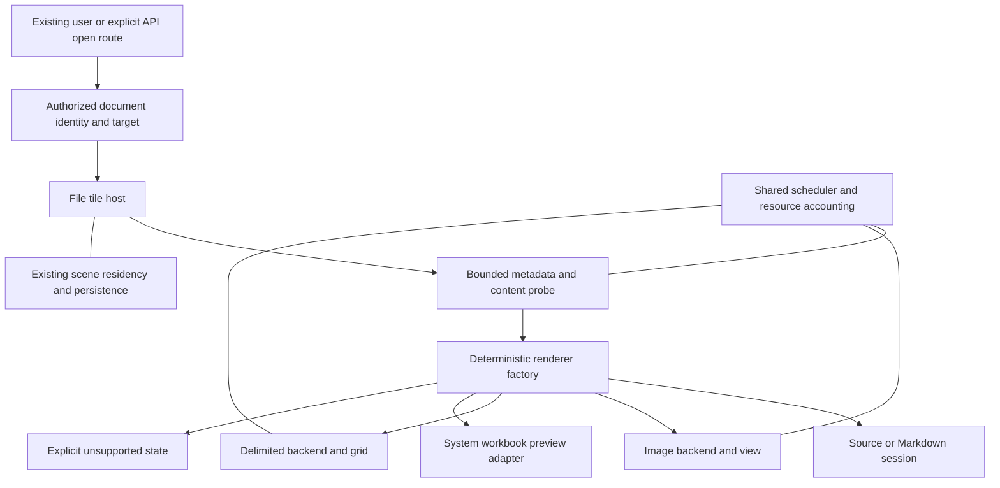

# Architecture contract for file renderers

Current concrete architecture and deviations are in [CURRENT IMPLEMENTATION](CURRENT-IMPLEMENTATION.md). This document preserves the original proposed contract, 2026-10-24. This defines behavior and ownership. Type/file names below are conceptual; choose final names from existing repository conventions after reading the landed performance interfaces.

## Current system and intended change

At the research baseline FileTileNSView combines the file shell, source/Markdown presentation, text session, recovery, monitoring, WebKit editor, focus and surface residency. It creates FileDocumentSession before loading FilePreview, causing eager text loading ahead of format dispatch. The local foundation now uses `FileDocumentInitialLoad` to materialize preview and text session from the same snapshot, with no session for unsupported input. See [IMPLEMENTATION](IMPLEMENTATION.md) for its tested boundaries; the renderer factory and full coordinator below are still proposed. Existing admission is UTF-8 text up to 1 MiB. See [architecture research](research/01-current-architecture.md) for source references.

Preserve the shell and editing behavior while extracting a small format boundary. Introduce the boundary through existing text plus the image renderer; do not design an abstract plugin system in advance of concrete needs.

## Ownership and dependency direction

| Component | Owns | Required constraints |
| --- | --- | --- |
| Existing open/placement layer | Authorization, project/zone, dedupe, persisted `.file` identity | No format-specific bypass; API opens retain explicit targeting semantics |
| File host | Document generation, selected renderer, chrome, focus routing, common load/error state | No CSV parsing, image decoding or workbook serialization |
| Shared loader/resource coordinator | Bounded scheduling, authorized reads, revision-aware sharing and cancellation | Resource accounting includes tile-held results; cache eviction alone is insufficient |
| Format backend | Validated metadata, paging/indexing/decoding, format-specific errors and bounds | No workspace navigation, canvas writes or AppKit dependency in Core |
| Renderer | Bounded visible views, selection, viewport and presentation revision | No file writes, independent project ownership or private polling timer |
| Text editing session | Baseline/draft, revision, explicit save, conflict and recovery | Created only for editable text; authoritative draft shared by source/preview |
| Scene residency | Live versus parked presentation and surface cache | Sole owner of its existing lifecycle; format resources cooperate with it |

Platform-neutral classification outcomes, delimited parsing and resource policies belong in Core where feasible. UTType/ImageIO/QuickLookUI/AppKit/PDFKit adapters stay in the app target. No Apple UI framework leaks into the Core/iOS dependency graph. Keep backend payload types specific: an image source, paged table and text draft need not share a universal content tree.

Use one explicit internal selection factory with stable precedence and an unsupported result. Extension and UTType are hints; bounded validation determines the actual supported content. Explicit source mode applies only within safe text bounds. Special files are rejected before streaming; supported document packages are handled deliberately rather than recursively scanned as arbitrary directories.

## Identity and loading sequence

Distinguish these values:

- Document identity: authorized canonical location and project/standalone scope.
- File revision: the bytes represented, including replacement identity. A timestamp/size pair alone can miss atomic replacement.
- Load generation: host request lifetime; increment/invalidate on document replacement, reload and retirement.
- Presentation revision: pixels visible in the body, including mode, zoom, scroll, selection and theme as required by residency.

The load sequence is resolve/authorize → bounded probe → select backend → load/index/decode → verify generation/revision → install presentation. File I/O and heavy parsing/decoding do not occur in init, layout or camera ticks. Initialize any text session from the same verified loaded snapshot instead of independently rereading bytes before dispatch. Inspect the current FileDocumentSession API before choosing the smallest compatible initialization change.

Publish through the main actor only after validating the current host and request identities. Queued work must be revocable; long parsers check cooperative cancellation. Synchronous system decoders may not stop mid-call, so bound concurrency and describe cancellation honestly. A source path swapped between authorization and read must not expose an unauthorized target; validate an opened descriptor/snapshot or an equivalent read-time policy and witness the race.

## Lifecycle and error states

| Transition | Required behavior |
| --- | --- |
| Open | Responsive loading state; no binary text session or accidental write |
| Ready | Display actual loaded revision and bounded/partial notices |
| External update | Coalesce changes, invalidate shared revision and reload; retain dirty text draft/conflict protection |
| Navigate to another file | Resolve text transition first, retire old work/body, start a new generation |
| Suspend or park | Follow scene residency; pause animation and unnecessary heavy work; retain only admitted resources |
| Resume | Validate freshness, recreate evicted resources, restore valid viewport state |
| Dispose | Invalidate generation, cancel queued work, release observers/resources and tear down once logically; repeated cleanup is safe |
| Failure | Distinguish missing, denied, malformed, unsupported, locked and resource-limited input with useful fallback |

Quick Look close is terminal; an explicitly closed view must be recreated. Suspending does not automatically mean closing. Do not publish an old success after removal, downgrade a new error with an old completion, or leave a generic loading spinner after a known terminal failure.

## System provider boundary

A Quick Look provider reads its input outside Array's normal backend. Passing the original URL does not automatically inherit the shared loader's authorized-read, stable-revision or resource guarantees. FT0 must select and prove an input policy before FT4: a verified immutable staged snapshot with bounded copying, private temporary lifetime and cleanup, or another evidenced read-time policy. Packages need bounded deliberate copying, and staging must preserve sufficient format identity for providers. Test replacement after authorization and during provider loading. A staged container alone does not prevent its external links/resources from being followed; qualify those separately with adversarial fixtures and observable effects.

Do not promise controls the provider API cannot enforce. If embedded preview cannot meet the access/resource contract for a format, leave it unsupported with explicit external open rather than silently weakening the contract. System service memory and work may be opaque: measure process/service behavior and repeated lifecycle cycles, limit concurrent active previews and define fallback criteria. Array-held cache counters alone do not prove a hard bound on provider resources. Record which limits are enforced versus measured qualifications.

## Editing and persisted state

Source/Markdown keep one authoritative draft. A CSV/SVG preview offered alongside editing must consume that draft, or require an explicit transition resolving it. Viewing, selecting, filtering, sorting and zooming never mark disk data dirty. A read-only viewer never creates recovery drafts, sends language-service events or invokes text save logic.

Persist only useful small view state, not decoded images, data rows, indices or system preview objects. Missing/unknown state defaults safely; stale page/sheet/viewport bounds clamp after content changes. Use stable sheet identity where possible. New real coding keys need WorkspaceAPIExposure classification. Exposed edits require a published operation with grants/persistence/visible-outcome witnesses; classification alone is insufficient.

## Resource and extension contracts

Image decoded bytes, table/index bytes, queued jobs and canvas surfaces have distinct budgets; count aggregate retained cost. Virtualize both grid axes. No work proportional to all file content during repeated layout. A partial result always states what is limited and what search/sort covers. Do not present a downsampled image as original-pixel inspection or cached workbook formulas as freshly calculated results.

To add another renderer, supply: selection/validation rules; real capabilities; typed backend/result and errors; admission/cache policy; lifecycle integration; minimal state schema; keyboard/accessibility behavior; format manifest and tests. Add only operations the host genuinely needs. PDF should require a factory entry and adapter, not edits to CSV parsing, text conflict logic or placement policy.

Architecture review questions: Can this renderer be removed without breaking another? Who cancels it? Who owns the bytes? Can its completion arrive after disposal? Does a new format require another host conditional at every lifecycle seam? Does inspection leave file bytes unchanged? Any unclear answer must be resolved before layering on another format.
