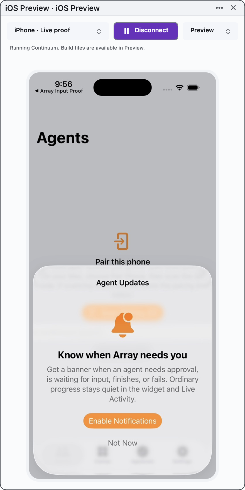
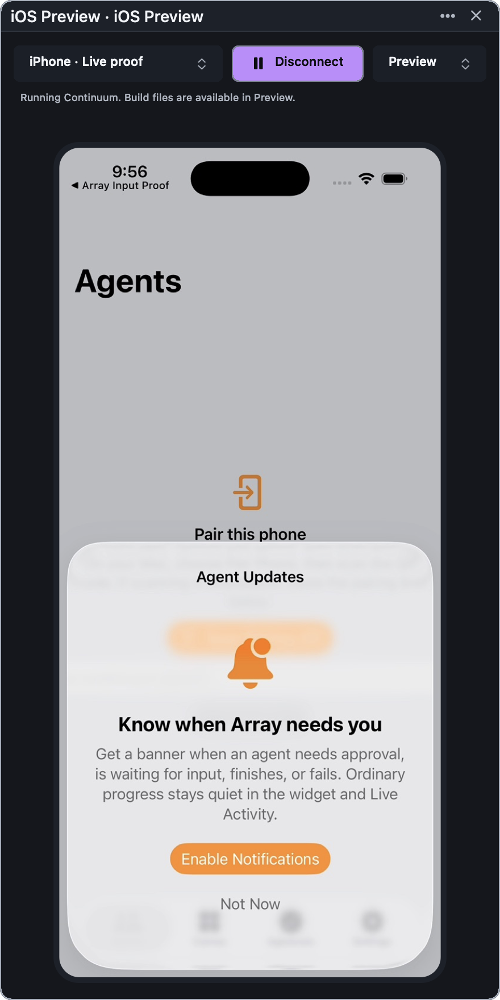
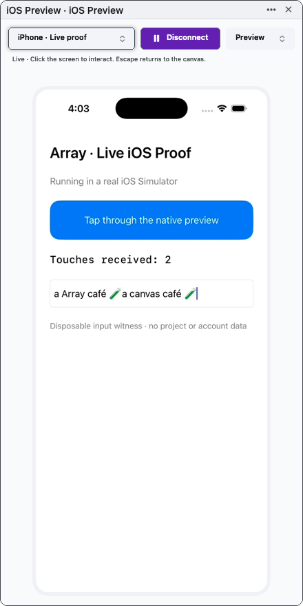
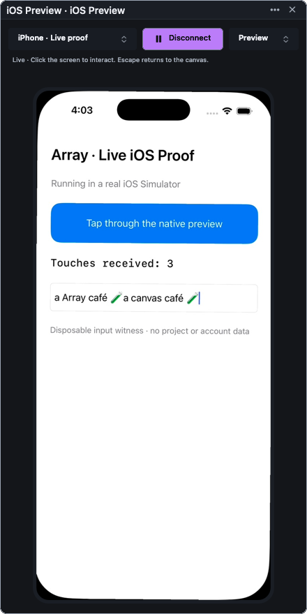
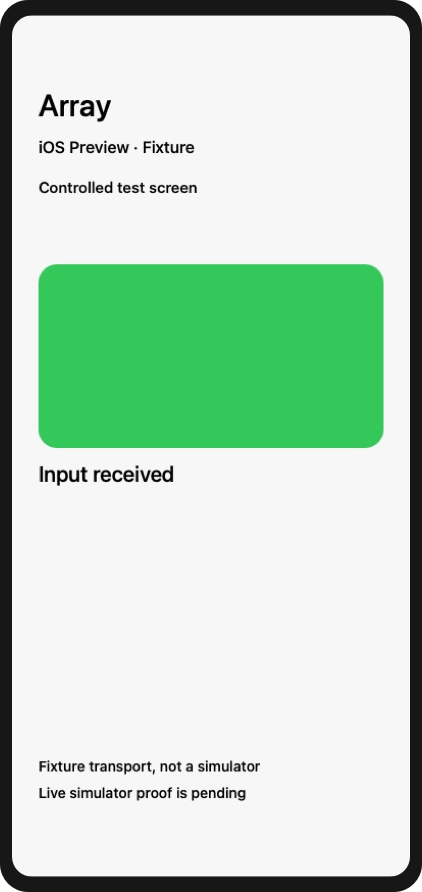
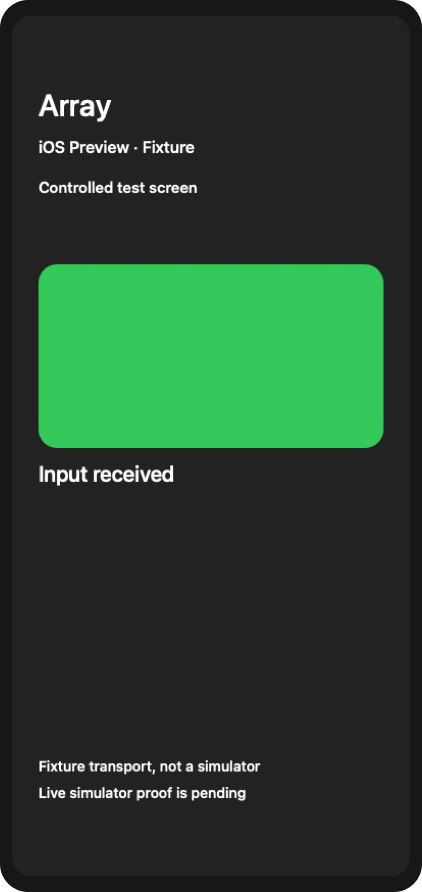

# First executable proofs — 2026-10-28

## Sanity and performance follow-up

The eight-agent pass adds worker-thread frame assembly, a measured **30 fps**
default, helper-exit reconnect fencing, bounded image/queue work, input focus and
paste fixes, robust bridge errors, process-group cancellation and build cleanup.

The real simulator comparison delivered **14.6 → 29.6 fps**, with median
AppKit-tap-to-decoded-frame latency **56.5 → 37.1 ms** at 15 versus 30 fps.
60 fps increased CPU without improving latency in this sample. These are short
shared-machine debug measurements, not physical display scan-out timings.

[Audit, measurements, limitations and final verification](sanity-and-performance.md).

## Build & Run follow-up

The tile now offers **Preview → Build & Run…** when connected. It discovers
Xcode containers/shared schemes in the owning project and its `ios` folder,
asks for a scheme, builds fresh products for that exact simulator, verifies the
app, then installs and launches it. Preview also offers cancellation and access
to retained build files. [Implementation contract](build-and-run.md).

- The targeted matrix passed **5 legs**. Its existing tile leg now runs
  IOSPreviewBuildChecks: literal argv with spaces, exact scheme/destination,
  fresh products, matching built plist, success receipt, failure/cancellation
  barriers and rejection of products outside the current build directory.
- The first run was RED because command cancellation did not settle after the
  stdout-to-file change. Restoring Foundation's Pipe ownership for captured
  stdout fixed the same cancellation witness; the matrix then passed.
- The live production tile built the actual companion (`Continuum`, bundle
  `dev.dylanreedx.continuum`) from fresh products, installed/launched it on its
  exact disposable simulator and kept receiving frames. Final live evidence
  also checks real Xcode scheme discovery and captures after the launch
  animation settles. The live matrix has 2 legs.
- Array Dev was rebuilt through `scripts/dev-app.sh --no-launch`. Its bundle
  verification passed identity/resources/signing/LaunchServices checks, but
  **failed twice on --terminal-theme-fidelity-check**, which timed out waiting
  for its terminal theme probe. This remains unresolved; this follow-up does
  not claim a passing bundle gate or a passing full release matrix.
- No notification behavior was changed. No commits or release were made.

Evidence: [offline matrix](proofs/build-run-matrix.log),
[cancellation RED](proofs/build-run-red.log),
[live matrix](proofs/build-run-live-matrix.log),
[production live checks](proofs/build-run-live-check.log),
[exact build receipt](proofs/build-run-receipt.json),
[device cleanup](proofs/build-run-summary.json),
[bundle verification failure](proofs/build-run-bundle-check.log).

| Light host | Dark host |
| --- | --- |
|  |  |

## Production canvas tile — implemented and verified

The first `iOS Preview` tile is implemented. Search **iOS Preview** in the
command center, choose an installed simulator, then Connect. It is a normal
project/zone-owned tile with an aspect-correct device screen. Connect may boot
the selected device; closing or hiding the viewer detaches capture/input and
leaves the simulator running. Restoring a saved tile does not boot or reconnect.
Only the exact selected UDID is persisted. A fresh selection connects in
portrait; a resumed viewer retains its chosen angle.

The production adapter uses the exact previously proved Expo native addon in
an owned Node process. Connect downloads pinned Expo/ws tarballs, checks SHA-512
integrity and preserves upstream notices. There is no npm lifecycle execution or
global installation. The helper accepts only authenticated loopback frame/input
requests, rejects browser Origins, and exits when its owning app disappears.
The compressed/decode/presentation and outgoing input queues are bounded.

Verification completed against this implementation:

- `scripts/run-matrix.sh --ios-preview-tile`: **5 legs passed**, including the
  new production mount/spawn/restore witness. It asserts nonzero-origin world
  frames, the owning store, preservation of unseen tiles, cold workspace return,
  explicit connection, exclusive device ownership, AppKit input, held-key release,
  parking and stale-frame rejection, injected write-failure rollback, real command
  cancellation and latest-frame decoding under a 1,000-offer burst.
- The mount witness was RED when materialization was deliberately disabled;
  its failure specifically named the descriptor left by the production mount.
- The first production live run was RED on landscape hit testing while portrait
  touch/paste already passed. Reversing the incorrect landscape transform made
  the same real UIKit button readback pass.
- The final live matrix ran **2 legs, both passed**, using the actual
  `~/Desktop/Array Dev.app/Contents/MacOS/Array` bundle executable. It verified
  real frames, clicks, physical keyboard events, Unicode/emoji paste, rotation,
  landscape clicks, landscape reconnect, fresh connection to an already-rotated
  device, and preservation of app state. The UIKit app writes its own state;
  host screenshot appearance alone is not the input verdict.
- The frontmost application in that run remained Slack before/after input.
  Simulator.app was not opened. The gate also restarted its standalone helper,
  installed/launched/captured the actual companion, and deleted its exact owned
  disposable simulator (`ownedDeviceDeleted: true`).
- `--ui-probe-check` passed the live appearance/adoption census, including the
  new tile. The production light/dark/landscape snapshots below were inspected.
- `scripts/check-app-bundle.sh --bundle ~/Desktop/Array\ Dev.app` passed resource,
  identity, signing and launch verification. The shared Dev app was rebuilt with
  `scripts/dev-app.sh --no-launch`; no regular preview window was launched.
- The companion `xcodebuild` for the generic iOS Simulator destination passed.
  Shell/Python/Node syntax, matrix inventory (720 records) and `git diff --check`
  passed. `scripts/benches.sh` was inspected; this work created no bench.

Evidence:

- [Offline matrix](proofs/production-tile-matrix.log),
  [mount negative control](proofs/production-tile-negative-control.log)
- [Real landscape regression](proofs/production-landscape-red.log),
  [final bundled live matrix](proofs/production-live-matrix.log),
  [production input checks](proofs/production-live-check.log)
- [Independent UIKit report](proofs/production-live-report.json),
  [live summary and cleanup](proofs/production-live-summary.json),
  [exact commands](proofs/production-live-commands.json)
- [Appearance census](proofs/production-appearance.log),
  [bundle verification](proofs/production-bundle-check.log)

| Light | Dark |
| --- | --- |
|  |  |

[Landscape production tile](proofs/production-tile-landscape.png). The landscape
fixture's content can overlap its iPhone notch because that disposable app uses
fixed horizontal padding; that is guest content, not a host clipping assertion.
Dark/light here refer to the host appearance; the guest retains its own theme.

This is a development implementation, not a release. Build & Run was added in
the follow-up above. Agent simulator APIs, iPad/physical-device verification, native trackpad scrolling,
IME/multi-touch and sustained H.264 performance remain outside this slice.
The renderer now defaults to 30 fps MJPEG capped at 1,400 pixels; the original
production proof below used 15 fps. Xcode 26.6 /
iOS 26.5 / Node 22.22.2 were exercised; Xcode 27 compatibility is not established.
The full release matrix was not run. No Git mutations or production app/project
state changes were performed.

The sections below retain the earlier feasibility proofs and initial permission
failures as history; their statements of missing production integration describe
those earlier runs.

## Live follow-up after the permission update

**Real simulator proof now passes. No new agent/session was needed.** The resumed
session has Full Access and CoreSimulator discovery succeeds on Xcode 26.6.
The earlier permission failures below describe the initial run only.

`scripts/run-matrix.sh --ios-preview-live` passed with **2 legs run**: inventory
and the opt-in live witness. The existing offline fixture matrix also passed
with **2 legs run** after the native harness was extended.

The live gate creates a new iPhone 17 / iOS 26.5 simulator, builds a tiny UIKit
input witness, then drives it through the native AppKit surface, loopback
WebSocket and T3-pinned Expo native addon. The app writes its own input state,
providing independent evidence that input reached iOS:

- A real AppKit mouse event increments the UIKit button counter.
- A second click focuses UITextField; native HID A down/up inserts `a`.
- Hardware Command-V pastes `Array café 🧪` from that simulator's pasteboard.
  Readback is `a Array café 🧪`; UIKit inserts an inter-word space. The first
  overly strict assertion rejected that spacing, then the assertion was corrected
  to accept it while still requiring exact Unicode/emoji content and prior text.
- Orientation commands change the app window from 402×874 to 874×402 and back.
- Restarting the native helper preserves the app's text and touch count, and a
  new AppKit connection receives frames again.
- The input proof records `dev.arrayapp.macos` as the frontmost host application
  both before and after; it never opens Simulator.app or activates the proof window.
- The actual companion builds successfully, installs and launches in the same
  disposable device. Its Agents/pairing screen and Agent Updates onboarding are
  captured through the native renderer. No production companion pairing was used.

The pinned addon resolves only the default device set. The live gate therefore
creates a uniquely named device in that set and targets its exact new UDID for
every operation. It never adopts an existing device. Both the exploratory run and
the repeatable matrix run stopped their helpers and deleted their own devices;
the final booted-device query returned none.

The first capture attempt exposed an Xcode 26 compatibility detail: capture works
but `activeScreenId()` can report no metadata. The upstream API documents zero
as the sole-panel fallback, and `setScreen(0)` enabled both touch and keyboard.
No Apple framework code was copied into the app process.

Evidence:

- [Live matrix report](proofs/live-matrix.log)
- [Live summary and cleanup](proofs/live-summary.json)
- [Input readback and foreground identity](proofs/live-input-report.json)
- [Rotation readback](proofs/live-orientation.json)
- [Native input witness output](proofs/live-input.log)
- [Exact live commands](proofs/live-commands.json)
- [Successful companion build excerpt](proofs/companion-build-success.txt)
- [Running companion in native preview](proofs/live-companion.png)
- [Real input app in native preview](proofs/live-input.png)

The input screenshot includes an iOS system onboarding notification; this is a
real simulator capture, not a composed mockup. The companion screenshot was
visually inspected. Earlier fixture light/dark snapshots remain below.

Live setup and replay are documented in
[Tools/IOSPreviewProof/README.md](../../Tools/IOSPreviewProof/README.md).
`run-live.py` owns simulator/helper creation and cleanup. `InputWitnessApp.swift`
has no account, project or relay connectivity. No global packages were installed;
the pinned `ws` dependency lives under this QA run.

Still outside this proof: production TileNSView/zone integration, persistence,
human keyboard-focus routing, rotated canvas hit testing, multi-touch and
sustained H.264/IOSurface performance. The current native display proof uses
MJPEG over loopback. Full release matrix was not run for this harness change;
targeted live/offline gates, syntax checks and diff-whitespace checks passed.

## Initial fixture run (before the permission update)

The native display/input transport is feasible. A live interactive iOS Simulator
inside Array is **not yet proven**: the current command sandbox denies access to
CoreSimulatorService, including discovery against an empty disposable device set.

## Passed

`IOS_PREVIEW_PROOF_OUT=qa-runs/ios-preview-proof/matrix-run scripts/run-matrix.sh --ios-preview-proof`

The final report names **2 legs run**, inventory and native proof, and passes.
The harness is rebuilt on each run, uses no network-fetched dependencies, and
starts only its own loopback fixture server. The full matrix also registers this
leg; no existing checks or known-red entries were removed.

- Real JPEG bytes stream over loopback HTTP and decode into a native AppKit view.
- AppKit mouse events produce tagged binary WebSocket input. The fixture records
  those events and changes its image; the native view receives changed pixels.
- Physical A down/up messages arrive in order. Dragging outside the screen clamps
  coordinates; losing focus releases an active touch.
- Four rotation transforms and letterboxed coordinates at four scale factors
  match explicit expected values. These are geometric scale checks, not actual
  production canvas gesture tests.
- Split multipart chunks survive parsing; oversized input is rejected and the
  parser recovers. A decoded-frame inbox retains one pending image after a
  1,000-offer burst and rejects old-generation input. This does not establish
  bounded scheduling throughout a production video pipeline.
- Detaching clears admission and pending frames; the fixture observes both stream
  and WebSocket connections close.
- The same witness rejects a separately compiled wrong-rotation implementation.
  That negative control fails specifically on landscape coordinate mapping.
- Light/dark native snapshots were generated and visually inspected.

One implementation bug was witnessed during development: independent asynchronous
send tasks could reorder input. The proof now drains input through one sequential
sender, and the final event trace contains begin → move → end → key down → key up.

Native snapshots are explicitly labeled fixture screens:

| Light | Dark |
| --- | --- |
|  |  |

## Backend preflight

`python3 Tools/IOSPreviewProof/probe-backend.py qa-runs/ios-preview-proof/backend`

Fetched `expo-device-hub@0.19.0-canary-20261023-1357114` and verified the tarball
against its registry SHA-512 integrity. Its bundled native Node addon loads in a
child process with Node 22.22.2 on this machine and exposes SimCapture/SimHID.
This establishes binary loading only; no capture or input method was exercised.
The preflight exits **1**, because isolated simulator discovery is unavailable.

Installed toolchain: **Xcode 26.6, build 17F113**. Compatibility with Xcode 27
remains untested here. No devices were created, booted, erased or adopted.

## Blocked and unverified

- `xcrun simctl --set <proof-output>/device-set list devices --json` exits 1 with
  CoreSimulatorService connection invalid/refused and a denied CoreSimulator log
  write. An earlier default discovery attempt failed similarly. No discovery
  result is treated as an empty installed-device list.
- The generic companion `xcodebuild` attempt exits 74 at package resolution:
  the sandbox denies writing SwiftPM manifest diagnostics under Library/Caches.
  The log also reports the unavailable simulator service. No companion app was
  built, installed or launched.
- Human keyboard focus, modifier routing, Unicode/IME/paste, real simulator HID,
  H.264/native surface throughput, actual TileNSView integration, persisted
  device selection and production zone/workspace hydration remain unverified.
- This fixture is deliberately not presented as a running companion or a canvas
  tile. No preview bundle was rebuilt or launched. Full matrix not run; only the
  new targeted matrix plus shell/Python syntax and diff-whitespace checks ran.

## Files and evidence

- Harness and replay instructions: [Tools/IOSPreviewProof](../../Tools/IOSPreviewProof/README.md)
- [Matrix report](proofs/matrix.log)
- [Fixture verdict](proofs/fixture-report.json)
- [Received input trace](proofs/input-events.json)
- [Negative control](proofs/negative-control.log)
- [Pinned backend report](proofs/backend-report.json)
- [Native addon exports](proofs/native-addon.log)
- [Simulator discovery failure](proofs/simctl.log)
- [Companion build failure](proofs/companion-build-error.txt)

No production application source, schema, project state, preferences, pairing or
Git history changed. Existing working-tree changes were preserved. New files are
the standalone harness, its matrix registration/inventory record, and this proof
record. No global dependencies were installed.

Next proof: use this native surface contract with a real dedicated simulator and
the exact pinned helper in a context that has CoreSimulator access. Require real
screen changes after touch, normal typing/paste while Array remains frontmost,
rotation, and helper crash recovery before implementing the production tile.
