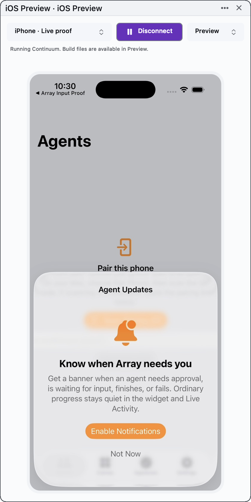
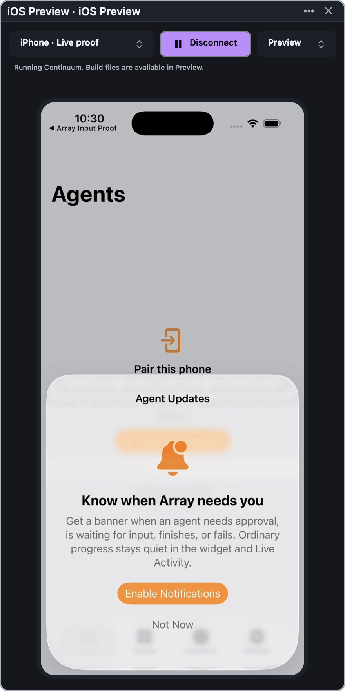

# iOS preview sanity and performance pass

Eight agents audited capture, decode/drawing, input, lifecycle, build/run,
transport, benchmark design and verification. The user's running preview and
simulator were left untouched during the audit; live checks use an exclusively
owned disposable simulator.

## Measured baseline

The first implementation captured MJPEG at 15 fps. The second `30` passed to
SimCapture configured its unused H.264 mode, so it did not raise MJPEG cadence.
A 15 fps clock has a 66.7 ms interval before capture/encoding/transport/rendering.

The isolated production bridge benchmark delivered 14.9 fps. Healthy loopback
transport was fast (p95 roughly 0.4–2.3 ms), while a paused consumer could receive
frames about 1.44 seconds stale on resumption. The bridge's JS write-buffer bound
does not bound bytes already buffered by TCP/the receiving process.

At 662×1400 pixels, isolated optimized ImageIO decode measured p50 0.93 ms and
correct NSImage drawing 1.46 ms. A supposedly faster CGContext path was vertically
incorrect; correcting its flip and copy blend produced equivalent performance
and identical pixels. The existing drawing path is retained.

## Changes

- Multipart assembly runs on a serial worker queue. Only decoded, coalesced
  frames reach the main actor. A blocked UI no longer blocks consumption of
  every compressed frame in the network stream.
- Decode/presentation queues have behavioral high-water witnesses. Oversized
  JPEG dimensions are rejected before bitmap allocation: maximum 4096 per side
  and four million pixels, alongside the four MiB compressed-part limit.
- Helper teardown retains the device lease until the actual old process exits.
  Reconnect cannot race old queued HID work or input cleanup.
- Pending consecutive pointer moves coalesce; begin/end/key order is preserved.
  Held modifiers survive Unicode paste. Window/app focus loss releases inputs
  even when AppKit retains the first responder. Key-down synchronizes modifiers
  that were already held before focusing the preview.
- Oversized/malformed WebSocket messages cannot terminate the helper through an
  unhandled error event. Closing a controller releases its inputs and fences
  queued work. Startup/shutdown races and stuck native cleanup have deadlines.
- Build status cannot override connection failures or leak from a previous
  operation/device. Hiding the preview pauses streaming while its explicit
  build continues; user disconnect, selection, parking and removal cancel.
- Command cancellation signals only the command's owned process group, with
  TERM then KILL escalation. The group leader stays unreaped through escalation
  to prevent targeting a reused group id. Deliberately detached descendants
  that escape that process group are outside this guarantee.
- Build stdout/stderr write directly to one retained log. Error reporting reads
  at most four KiB and presents a 1400-character tail. Completed/cancelled runs
  remove only their own DerivedData, retaining logs and receipts. Before this
  cleanup, each tested run retained about 1.53 GiB. Builds still start with fresh
  products and cold-build speed remains a separate improvement opportunity.

## Behavioral evidence

The matrix's existing --ios-preview-tile-check now covers worker-stream
assembly while main is blocked, latest-only delivery, queue high-water limits,
decoded dimension limits, warm workspace return, helper-exit fencing, input at
three zooms and four orientations, letterbox rejection, clamped outside drags,
key/window focus loss, failed device-selection rollback and expanded build
failure boundaries. New matrix legs exercise the actual bridge with dependency-
free stand-ins and compile/run the production command runner against owned
process trees.

Retained RED controls include the original modifier-paste failure, original real
WebSocket helper crash, original escaped owned-child cancellation, old status
precedence and a temporary receiver moved back onto the blocked main queue.

The opt-in real benchmark sends twelve native AppKit taps at each of 15/30/60
fps and observes the first changed UIKit marker in a decoded production frame.
It also samples three seconds of animated frame cadence, host/helper process CPU
and RSS. It measures input-to-decoded-frame delivery, not physical screen
scan-out or human global event routing. Timing has no hard pass threshold;
marker/counter outcomes are required. Shared-machine load and short sample
windows limit interpretation of CPU/RSS and percentile comparisons.

## Real simulator comparison

The production tile measured one owned iPhone 17 / iOS 26.5 simulator on this
Mac (debug app). Twelve marker-confirmed AppKit taps per rate, followed by the
existing real typing/paste/rotation/reconnect checks, passed.

| Requested | Delivered fps | Tap → decoded frame p50 | p95 | Host CPU | Helper CPU |
| --- | ---: | ---: | ---: | ---: | ---: |
| 15 fps | 14.6 | 56.5 ms | 75.4 ms | 17.8% | 8.8% |
| 30 fps | 29.6 | 37.1 ms | 55.5 ms | 38.7% | 16.0% |
| 60 fps | 59.6 | 40.4 ms | 65.2 ms | 75.1% | 25.9% |

30 fps is the new default: roughly twice the delivered cadence and 34% lower
median input-to-decoded-frame latency in this run. 60 fps consumed almost twice
the host CPU of 30 fps without improving the sampled latency. CPU percentages
are process CPU time / wall time (100% means one core), not total-machine usage.
These short shared-machine samples guide this default; they are not a sustained
performance claim. The benchmark stops before physical display scan-out.

Host RSS after the sampled windows was about 76–105 MiB, helper RSS about
85–93 MiB. These are short-window RSS samples; they do not establish long-term memory
stability or prove the absence of leaks.

Raw first comparison: qa-runs/ios-preview-perf/live/canvas/performance-report.json.
## Final verification

- `scripts/run-matrix.sh --ios-preview-tile`: **7 legs passed**, including the
  new bridge and command-process-tree legs and all expanded production checks.
- `scripts/run-matrix.sh --ios-preview-live`: **2 legs passed** for the real
  15/30/60 comparison. A second run at the final 30 fps default also passed both
  legs, real companion discovery/build/install/launch, hiding during build,
  continued live frames, and scoped DerivedData cleanup. Both owned simulators
  were deleted. The final build directory retained only build.log and run.json.
- `--ui-probe-check`, `--workspace-scene-owner-check` and
  `--workspace-api-open-check` passed with isolated stores and tmux disabled.
- `scripts/dev-app.sh` rebuilt/relaunched Array Dev on its pinned scratch root;
  its process was verified after the launch tool returned. Production Array was
  untouched. Both final host appearances were rendered and inspected.
- `scripts/check-app-bundle.sh` **passed** against the refreshed Dev bundle,
  including the terminal-theme probe that timed out in the previous slice.
  No terminal-theme code was changed; earlier failed probes remain historical.
- Syntax checks, matrix inventory, `git diff --check` and bench inventory passed.
  No worktree was created or removed. No Git mutations were performed.

The full release matrix was not run. Native trackpad scroll, IME/multitouch,
physical devices, iPad live input and Xcode 27 remain outside these proofs.
Sustained multi-tile/long-duration memory and physical scan-out latency are not
claimed. Build products remain fresh per run, so repeated builds still cold
compile; shared cache optimization remains future work.

Evidence: [offline gate](proofs/sanity-matrix.log),
[live gate](proofs/sanity-live-matrix.log),
[live check](proofs/sanity-live-check.log),
[device cleanup](proofs/sanity-live-summary.json),
[raw measurements](proofs/sanity-performance.json),
[bundle manifest](proofs/sanity-bundle-manifest.json),
[appearance census](proofs/sanity-appearance.log).

RED/GREEN controls: [paste RED](proofs/sanity-bridge-red.log) /
[bridge GREEN](proofs/sanity-bridge-green.log),
[command tree RED](proofs/sanity-command-red.log) /
[command tree GREEN](proofs/sanity-command-green.log),
[main-queue receiver RED](proofs/sanity-stream-red.log) /
[worker receiver GREEN](proofs/sanity-stream-green.log).

| Light host | Dark host |
| --- | --- |
|  |  |
