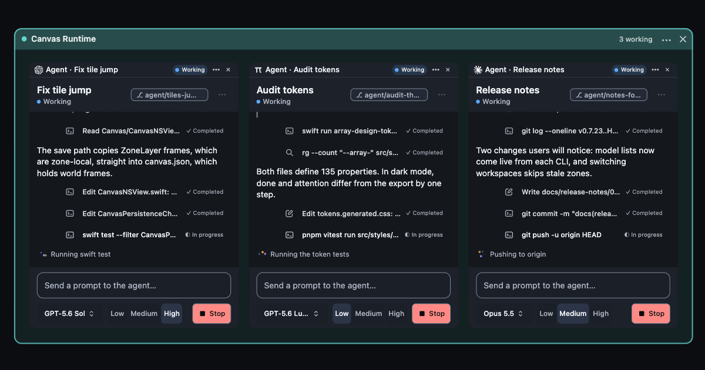

# Array

[](LICENSE)

**Array is a free, open-source macOS workspace for coding agents.** Keep agents, terminals, browsers, files, and dev servers together on one spatial canvas, with each project organized in its own zone.

[Download the latest alpha](https://github.com/dylanreedx/array-releases/releases/latest) · [Explore the source](https://github.com/dylanreedx/array) · [Report a problem](https://github.com/dylanreedx/array/issues)



Try the interactive walkthrough at [arrayapp.dev](https://arrayapp.dev). Array is in alpha; feedback and bug reports are welcome in [GitHub Issues](https://github.com/dylanreedx/array/issues).

## Build from source

Array is a native macOS app and requires macOS 14 or newer, Swift 6.2 or newer, and a macOS `GhosttyKit.xcframework` built from a [Ghostty source checkout](https://github.com/ghostty-org/ghostty). The framework is not included in this repository.

1. Install Xcode or the Xcode Command Line Tools with Swift 6.2 or newer.
2. Build GhosttyKit by following the Ghostty project's macOS development instructions.
3. Clone Array, then point the preparation script at that Ghostty checkout:

   ```sh
   git clone https://github.com/dylanreedx/array.git
   cd array
   GHOSTTY_SRC=/path/to/ghostty scripts/prepare-ghosttykit.sh
   ```

   This links the checkout's `macos/GhosttyKit.xcframework` into the ignored `ThirdParty/` directory. The script expects the framework to exist already; it does not build GhosttyKit.

4. Build and run the development app:

   ```sh
   swift build --product Array
   .build/debug/Array
   ```

   To assemble a development `.app` bundle instead:

   ```sh
   scripts/make-app-bundle.sh --configuration debug --output /tmp/ArrayDev.app
   open /tmp/ArrayDev.app
   ```

Development builds use Array Dev's separate app data and leave the production app's data alone.

## Contributing

See [CONTRIBUTING.md](CONTRIBUTING.md) for the repository workflow. Open a [GitHub issue](https://github.com/dylanreedx/array/issues) for bugs or suggestions.

## License

Array is licensed under the [MIT License](LICENSE). Third-party components retain their own terms; see [LICENSES/THIRD_PARTY.md](LICENSES/THIRD_PARTY.md).
