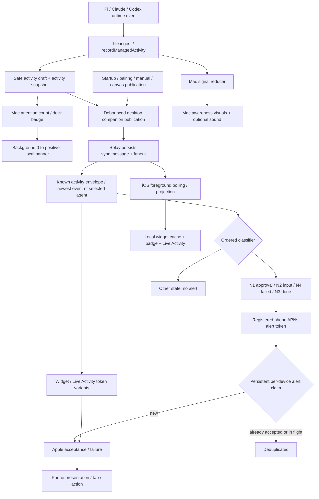
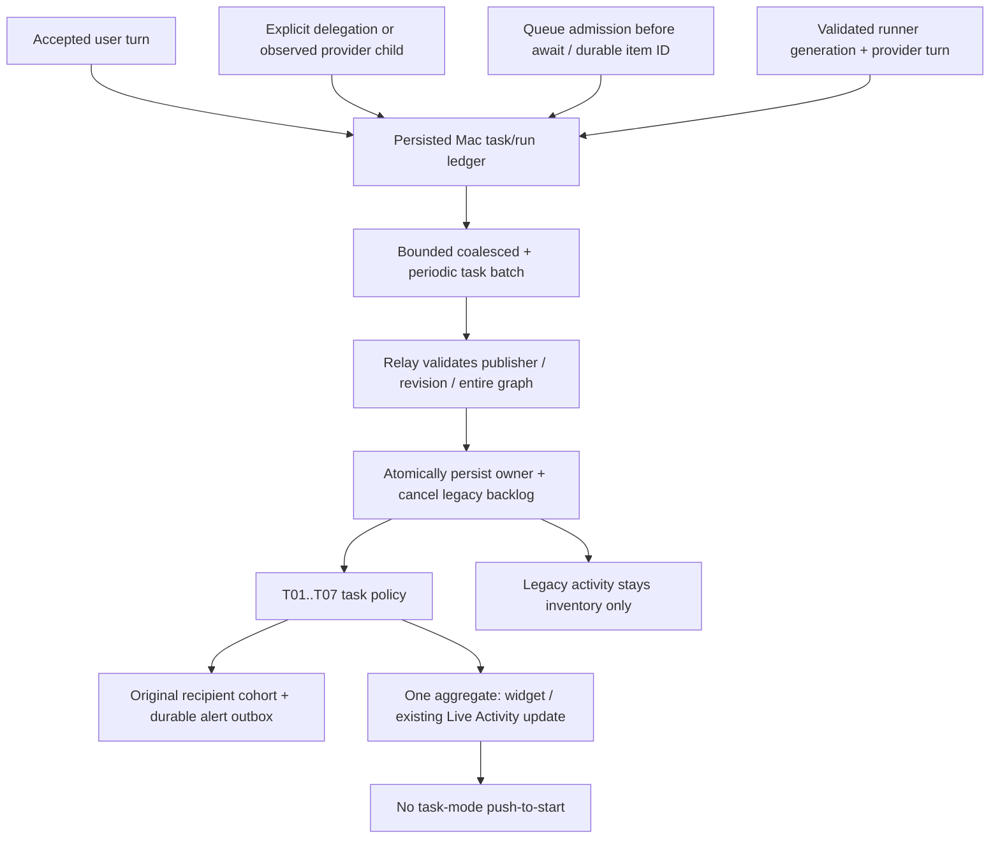

# Notification paths

Maintained contract and source inventory. Last audited: 2026-10-29.

Every Array-owned agent notification needs a stable path ID and an explicit
trigger → policy → recipient → delivery surface → tap/action → outcome chain.
Silence, suppression and failure are outcomes and must be mapped too. Changes
to any edge update this document in the same change. Unclassified paths are
release blockers. See the repository AGENTS.md rule.

This map distinguishes source coverage, offline witnessed behavior and device behavior. Current
behavior and proposed behavior below are deliberately separate. There is no
device exhaustiveness proof. `scripts/check-notification-map.py --self-test`
checks the owned sender census in `notification-senders.json` and mapped hosted
decision IDs. RelayCoreChecks exercises every hosted decision path and actual
requests through an injected APNs transport. The targeted matrix command is
`scripts/run-matrix.sh --notifications`. The census is a structural tripwire for
known APIs; it does not prove behavior or detect arbitrary new/dynamic APIs.

Scope: phone pushes, notification actions, badge/widget/Live Activity updates,
Mac agent attention banners/badges/sounds and CLI update banners, plus diagnostic
senders. Framework NotificationCenter/LSP/JSON-RPC messages are internal buses,
not user notification paths. Ordinary workspace error/status notices and command
error beeps remain local UI feedback: they do not authorize a phone notification.
External CLIs, arbitrary shell commands and OS-generated notices are outside
Array's owned senders; a new official integration must enter this inventory.

## Current production graph

Important: the current relay selects one agent from known activity wrappers;
it reads the newest event of that agent's canonical recent ring. It does not
derive a truthful whole-workspace aggregate or compare with its previous state.
Already accepted source-event identities are now persistently deduplicated per
alert recipient. A publication trigger is not itself proof of a new event or
that the entire task has finished.

## Source entry points and publication paths

| ID | Trigger | Processing and destination | Coverage / limitation |
| --- | --- | --- | --- |
| SRC-01 | Managed turn starts/completes/fails/interruption/cancellation | ManagedAgentActivityBridge → activity draft → desktop publication | Common provider-neutral path; runId currently nil |
| SRC-02 | Tool starts/completes/fails; runtime error | Safe generic activity draft → same publication | Hosted classification uses status/outcome, not tool significance; raw errors excluded |
| SRC-03 | Approval request opens/resolves | Draft includes request ID → same publication | Resolved events still contain request ID; hosted classifier has no resolution-aware suppression |
| SRC-04 | Git push/merge semantic signal, child spawned, settled compaction event | Safe activity milestone → same publication | No dedicated hosted category; a selected stale done/attention status can still trigger |
| SRC-05 | Content delta, token/context telemetry, session-state event, user-input requested/resolved; in-progress compaction | Bridge returns nil | No rich draft from this bridge; other snapshot/status producers can still represent a status. User-input events do reach Mac signal reducer |
| SRC-06 | Observed terminal/session status and registry-wide activity rebuild | Activity snapshot and Mac attention projection | Includes terminal sessions; must distinguish managed agents from shells |
| PUB-01 | Rich managed activity draft | Installed app: trailing 0.5 s; source: bounded 0.5 s companion publication | Legacy activity drafts remain tile-ingest dependent; source authoritative headless task producer is HOST-01…06 |
| PUB-02 | Startup, pairing change, explicit/manual sync | Companion snapshot publication | A replayed terminal row can classify again |
| PUB-03 | Canvas persistence/change | Debounced spatial publication (1 s) | Spatial payload is excluded: only activity envelopes are notification candidates |
| PUB-04 | Authenticated HTTP POST /v2/events or WebSocket publish | Current source: event plus eligible alert intents commit together → fanout → sender wake; recovery worker also drains alerts. v15 deployed sender still uses detached delivery without outbox | Both entry points reach same sender; GET replay does not itself invoke sender |
| PUB-05 | Invalid payload/auth, decoded event >8 MiB, HTTP body >24 MiB, non-sync.message, no known activity envelope/event, unknown activity wrapper | Rejection or no system-surface projection; size rejection logs only reason/byte bounds | No APNs request; rejected publish does not advance cursor. HTTP ingress is bounded before decoding. No arbitrary traversal of transcript/spatial payloads |

PUB-04 retention: latest spatial bootstrap plus up to 2,000 ordinary events,
bounded to a newest suffix of 16 MiB per instance. Existing Mac activity snapshots
are ordinary events. Size/count pruning is silent and does not send notifications;
GET replay itself never sends a push. Payloads up to 8 MiB can publish, including
existing Macs that previously received `payloadTooLarge` above 512 KiB. This is a
bounded compatibility fix; arbitrary event clients still need cursor-gap recovery.

Sources: `ManagedAgentActivityBridge.swift` in Core/AgentProviders;
`recordManagedActivity`, `scheduleCompanionSyncPublish`, `agentActivity` in
App/ContinuumApp.swift; Sync/DesktopCompanionSyncService.swift;
RelayNIO/RelayServer.swift.

SRC/PUB rows describe the installed legacy activity stream unless a source
variant is stated. HOST/OWN below are the independent source-only task producer
and handover; after OWN-01, legacy activity is inventory rather than a second
hosted notification source.

## Hosted alert classifier: exhaustive ordered branches

### Explicit task state (implemented in source; not deployed)

Source schema 4 accepts authenticated desktop `kind=task.batch.v1` with a
persisted publisherID, monotonic revision and full bounded task snapshot. Each
task carries version 1, taskID, rootRunID, membershipComplete and members
(agentID, runID, parentRunID, state, optional requestID). `task.state.v1` remains
the pure classifier's input; standalone network publication is rejected.
The source Mac supervisor supplies explicit accepted-turn/delegation/queue
provenance independently of tile ingestion. Neither Mac nor relay source has
been rolled out: installed Mac + production Fly v15/schema 2 retain the legacy
activity classifier below. No production consolidation claim follows from these
source changes. OWN/HOST paths describe the handover and producers.

| ID | Trigger / policy | Outcome / recipient / tap |
| --- | --- | --- |
| T-01 | Malformed/unsupported task, duplicate runs, missing root/parent, cyclic/disconnected ancestry, attention missing bounded request identity | Reject projection; no surface request |
| T-04 | Valid member needs approval/input, including while membership incomplete | One selected blocker alert to active registered phone, linked to that member's agent; approval prioritized then stable run order; identity includes task/run/request |
| T-02 | No attention; incomplete membership, unknown state, or cancelled child without evidence of successful objective | Quiet, nonterminal projection; never infer completion |
| T-03 | No attention/unknown membership; any running or queued run, including grandchildren | Quiet; child success and parent success while descendants run cannot produce completion or end Live Activity |
| T-07 | All runs settled; root cancelled/interrupted | No completion alert; cancellation semantics on other surfaces |
| T-05 | All runs settled, root not cancelled, at least one failed run | One root failure alert; no standalone child failure while root runs |
| T-06 | Complete membership and every participating run succeeded | One root completion alert |

T-04/T-05/T-06 share existing active-recipient filtering, persistent leased claims,
Apple failure handling and deep links. Terminal collapse is per task rather than
instance; terminal identity is stable across snapshot reorder/replay and distinct
for a new task using the same agents. Existing DEL/SUR delivery paths still apply;
Task mode suppresses push-to-start and publishes one workspace aggregate to existing update tokens/widgets; simultaneous attention fanout remains outstanding.
The alert outbox below now applies in source; no settle window has been added. Host lifecycle and ownership have offline checks; physical phone receipt/display and exact-task navigation remain unverified. Matrix evidence is recorded in the slice handoff.

Evaluate top to bottom against the selected object. Conditions overlap; order
is part of the current behavior. Names are sanitized; payloads omit transcript,
source summary, paths and tools. Current alert destination is every active
`.apns` registration row for the desktop instance, not a task-selected phone.

| ID | Condition, after earlier rows failed | Category / visible result | Interruption / collapse | Current tap |
| --- | --- | --- | --- | --- |
| H-01 | status=needsAttention AND approvalRequestId present | N1: Approval requested | Time-sensitive, no collapse | Payload agent deep link; Approve/Deny actions registered |
| H-02 | status=needsAttention | N2: Agent waiting for input | Time-sensitive, no collapse | Agent deep link; Open action |
| H-03 | Settled status AND terminalOutcome=failed OR runtimeError | N4: Agent failed | Active; instance-wide terminal collapse | Agent deep link |
| H-04 | Settled status AND terminalOutcome=succeeded OR status=done, excluding H-06 | N3: Agent finished | Active; same instance-wide terminal collapse | Agent deep link |
| H-05 | Working/configuring/stale even with an older terminal outcome, or idle without outcome | No alert payload | No alert request; other surface variants can still update | None |
| H-06 | Settled status AND terminalOutcome=cancelled/interrupted | No alert; cancelled Live Activity cannot claim completion | Non-alert surfaces can update/end with idle phase | None |
| H-07 | Selected activity has invalid agent UUID | Reject projection | No surface request | None |
| H-08 | Selected activity has non-string/unknown status or malformed/unknown terminal outcome | Reject projection | No surface request | None |

Validation H-07/H-08 runs first; attention H-01/H-02 then wins; non-settled
H-05 precedes terminal handling; cancellation H-06 precedes failure/completion.
Each decision uses RelayNotificationPath and emitted alerts carry notificationPath.
Current defects still present: attention wins over failure; one child completing can
alert while parent or siblings work; snapshots still select only one agent. Preferences,
task ancestry, prior state and foreground agent visibility are not consulted.
APNs collapse is not a completion barrier or durable application dedupe.
Durable dedupe now comes from notification_claims, not the collapse header.

Source: RelayCore/RelayAPNSService.swift, `project`, `findActivity`, `makeRequest`.

## Authoritative host and exclusive ownership (source only)

| ID | Trigger | Policy → recipient/surface → outcome |
| --- | --- | --- |
| HOST-01 | Accepted ordinary user send, including headless agent | Persist new task/root run before starting runner; later sends do not inherit lifetime agent ancestry; stream content is never serialized |
| HOST-02 | Explicit agent delegation/new child, or provider-observed child | Bind actual parent run; provider source replay reuses original child membership, including after parent starts a new task |
| HOST-03 | Accepted queue/steer/queued compaction/readiness hold | Commit admission barrier and reserved run before storage await; durable item UUID follows normal drain, forced send and consumed steer; accepted queued work prevents completion |
| HOST-04 | Matching provider lifecycle/request, cancellation/queue clear | Current runner generation plus provider turn fence; cancelled queue stays cancelled; consumed steer settles with parent; child result settles its own run only |
| HOST-05 | Restart, restored backup, imported legacy queue, missing result, invalid request identity, unknown background work or unrouted provider descendants | Persist/retain unknown or incomplete membership; no guessed success. Restored queues hydrate without a tile. A newer relay revision fences an older local backup. Buffered provider events withhold membership until their announcement supplies a valid parent route; invalid announcements keep it incomplete |
| HOST-06 | Task metadata changes; continuous activity; paired service running | App uses bounded 0.5s coalescing, service serializes/join-repeats latest task publication before inventory, periodic 10s task refresh; missing canvas/inventory cannot block task metadata |
| HOST-07 | Relay lacks advertised task.batch.v1 capability | Keep legacy inventory/publication; do not activate task ownership. Owner mismatch, ledger failure or wire capacity failure withholds task publication with redacted diagnostics; inventory remains useful |
| OWN-01 | Valid full task batch commits | First batch establishes publisher and quiet baseline atomically with event/outbox supersession. Baseline decision IDs stay quiet across interim unknown/recovery. Later task decisions fix currently active recipient cohort; replay cannot enroll a newly paired phone |
| OWN-02 | Legacy sync.message after task owner exists | Inventory persists/fanout continues; no legacy alert, widget or Live Activity sends; pending pre-handover legacy alerts close in the ownership transaction |
| OWN-03 | Older batch revision or delayed delivery wake | Event may commit as inventory history; no owner rollback, old alert enqueue or stale aggregate wake. Already submitted Apple requests cannot be recalled |
| OWN-04 | Same publisher/revision with different canonical task graph | 409 notificationRevisionConflict; event/sequence/ownership/outbox roll back together. Canonical member/task order alone does not conflict |
| OWN-05 | Different publisher attempts to claim an owned instance | 409 notificationOwnerMismatch; no takeover or reset. Restoring/replacing publisher identity needs a future explicit recovery workflow |
| OWN-06 | Invalid batch/graph/version/bounds or standalone task.state.v1 publish | Reject entire publication; no partial task ownership or notification. Companion credentials cannot read owner/publish state |
| OWN-07 | Task delivery/sign/storage preparation or ownership lookup failure | Static redacted failure diagnostic; unavailable ownership evidence suppresses legacy fallback on every hosted surface. Committed alert intents retain outbox recovery semantics; best-effort widget/Live Activity update is not retried |

Task snapshots retain every live/unknown/incomplete task plus the newest 128
settled tasks. Local provenance/tombstones are retained; snapshot history is not
local ledger garbage collection. Wire limits: 512 tasks, 4,096 members total,
1,000 members per task. Exhausting those bounds with unsettled work throws and
withholds publication; it never truncates unknown/live membership into a false
completion. Local ledger and compact relay ownership/tombstone growth still need
a retention policy. Local ledger uses AtomicWriter + three backups; unreadable
state does not mint a fresh publisher. Unknown imported queue provenance and
late/promoted steer receipts, indeterminate compaction and crash-window admission/dequeue ambiguity stay conservative and may withhold a
completion indefinitely. Queue-store persistence failures also cannot prove
successful work. This slice adds no automatic recovery inference.

Attention targets the actual member's agent with existing N1/N2 actions.
Task alerts in source now carry exact agent/task/run/instance destinations (IOS-03); deployed v15 retains agent-only links. Physical phone navigation,
chat, foreground-view suppression, category budgets/preferences and recovery after
a failed/cancelled child remain future slices. The agent `array_notify` tool is
NOTIFY-01…07 below.
No settle-window timer has been added. Hosted task mode is one source across
alert/widget/Live Activity pushes; Mac-local awareness and phone-local surface
projection retain their separately mapped behavior.

## All declared phone categories

| ID | Code | Declared meaning | Current hosted automatic trigger | Other sender |
| --- | --- | --- | --- | --- |
| CAT-01 | N1 | Approval requested | H-01 | Diagnostic fixtures |
| CAT-02 | N2 | Waiting for input | H-02 | Diagnostic fixtures |
| CAT-03 | N3 | Finished | H-04 | Diagnostic fixtures |
| CAT-04 | N4 | Failed | H-03 | Diagnostic fixtures |
| CAT-05 | N5 | Still-working digest | None implemented | Diagnostic fixtures only |
| CAT-06 | N6 | Desktop connection changed | None implemented | Diagnostic fixtures only |
| CAT-07 | N7 | Device/security changed | None implemented | Diagnostic fixtures only |
| CAT-08 | N8 | Session reaped/revived | None implemented | Diagnostic fixtures only |

Core PushCategory declares N1–N5/N7 enabled by default, N6/N8 disabled, N7
non-muteable. Those preferences govern the separate Core sender; they are NOT
enforced by the hosted classifier. A declared category or registered action
does not prove a production trigger. N7 currently does not notify on revocation.

## Other phone surfaces and device lifecycle

| ID | Trigger → route | Result / silence / failure |
| --- | --- | --- |
| SUR-01 | Projectable relay event → `.widget` token | Background APNs, instance widget collapse, no banner; token kind supported but ordinary phone setup does not register a separate widget token |
| SUR-02 | Projectable relay event → `.liveActivity` token | Live Activity update/end; terminal projection ends it; currently based on one agent, so can end while others run |
| SUR-03 | Each projectable relay event → `.liveActivityStart` token | Push-to-start payload; terminal still uses end; same one-agent aggregation weakness. Repeated working snapshots can resend start; no durable per-task start gate. Apple accepted repeated working starts in the v15 recovery sample; resulting phone activities were not observed |
| SUR-04 | iOS projected rows → SystemSurfaceCoordinator.publish | Writes app-group widget cache, reloads timeline, sets badge to attentionCount, updates/starts/ends local Live Activity |
| SUR-05 | Local Live Activity counts become zero | End existing activity; no independent alert |
| SUR-06 | Phone unpairs/clears | Best-effort unregister all token kinds; clears widget, badge and local Live Activity; no security push generated |
| REG-01 | Paired phone enables permission, or already authorized | registerForRemoteNotifications → token callback → save token → hosted registration |
| REG-02 | Permission denied / not now / token registration fails | No successful registration through that attempt; diagnostics only |
| REG-03 | Token rotates / pairing reconfigured / activity tokens appear | Upsert registration by device+kind; activity-start observation requires supported iOS |
| REG-04 | Unregister request fails while unpairing | Local credentials/tokens still clear; server registration may remain |
| REG-05 | Desktop/admin revokes device credential or whole instance | Push lookup requires a live instance and active companion credential for the device; all four surfaces are excluded, including after restart. Cached socket command authority is a separate remaining gap |

Sources: iOS SystemSurfaceCoordinator.swift; RelayCore/RelayStore.swift;
iOS PushNotificationAppDelegate in ContinuumApp.swift; SystemSurfaces models.

## Delivery and presentation outcomes

The source outbox below is implemented but **not deployed**. Production v15
retains the earlier best-effort alert delivery until a separately authorized
rollout. Non-alert widget/Live Activity surfaces still use best-effort delivery
in the new source too.

| ID | Condition | Current outcome |
| --- | --- | --- |
| DEL-01 | APNs inputs missing at relay startup | No pushDelivery service/worker; sync operates and eligible alert intents remain bounded in SQLite until configuration is restored or they expire; capacity rejection stays explicit |
| DEL-02 | Configuration/key setup throws | Startup/configuration error path; not notification delivery |
| DEL-03 | Projection absent, no registrations, inappropriate kind payload, empty token | No request for that path/registration |
| DEL-04 | APNs request succeeds | Alert acceptance tombstone and removal of queued body commit together; acceptedByApple trace is distinct from phone display |
| DEL-05 | APNs HTTP 410 | Alert: terminate intent and invalidate only the token generation used by that attempt, preserving a token registered meanwhile. Non-alert surfaces retain legacy registration invalidation. tokenInvalidated trace |
| DEL-06 | Other APNs HTTP status, transport/sign/storage failure | Provider outcome trace plus OUT lifecycle below: alert transient failures retry; permanent responses close. Non-alert surfaces remain best effort. Worker preparation/storage exceptions log OUT-12 without error values |
| DEL-07 | Relay exits after committed publication, before detached delivery | Event and eligible alert intents already committed atomically; worker recovers without a new publication. Before-commit failure rolls back event/sequence/intents together |
| DEL-08 | Same accepted source event is republished with a new relay sequence, or arrives concurrently | Per-registration transactional claim suppresses a repeated alert; deduplicated trace. Digest uses agent/request/run and decision path plus source timestamp; falls back to source sequence/replica when timestamp is absent. Inventory positional renumbering does not create a new event. Summary/name/transcript are excluded |
| DEL-09 | Attempt abandoned before completion | Worker reclaims its 120 s lease without republish; stale lease owners cannot finalize replacement work or revoke a fresh token |
| DEL-10 | Provider rejection or transport exception | Alerts use bounded automatic retry below. Source replay cannot reset due time, expiry or total attempt budget |
| IOS-01 | Notification arrives while app foreground | Delegate requests banner/list/sound/badge, including when viewing that agent |
| IOS-02 | Notification arrives background/terminated | OS presentation subject to device authorization/settings; physical acceptance not yet witnessed by this audit |
| IOS-03 | User taps notification or Open | Source: validated array/continuum agent UUID link → paired-instance fence → Agents NavigationStack exact agent. Cold launch buffers the URL until model/pairing loads. Task alerts carry task/run/instance IDs and show that exact task, never the latest task on a reused agent. Legacy links open the agent with an explicit missing-task message. Invalid/foreign links show unavailable; missing/deleted agents remain unavailable rather than opening another agent. No command authority from a URL. Production v15/installed phone still select only a tab. |
| IOS-04 | User chooses Approve/Deny | handlePushAction checks scope/IDs → respondToApproval; errors logged. Production desktop seam currently unknownRequest; do not claim working approval execution |
| IOS-05 | Remote background callback | refreshNow + non-navigating deep-link handling; callback reports newData, but relay refresh does not await an actual new fetch |
| IOS-06 | Missing model, invalid action/IDs or insufficient scope | No valid approval intent; may fall back to opening deep link; no implicit authority |

### Durable hosted alert outbox (source only)

Only `.apns` alert intents enter this queue; policy-suppressed/unprojectable
events never enqueue banners. The installed Mac's legacy classifier and the
opt-in task classifier both enter the same outbox after policy. Queue bodies are
AES-GCM sealed redacted alert envelopes bound to instance/recipient/decision,
with no original summary/transcript,
registration token or authorization header. Tokens and authority are read fresh
before each attempt; JWTs are generated by the sender. Existing relay event
payloads retain their existing storage behavior; outbox encryption is not a
claim that every relay table is encrypted.

| ID | Trigger | Outcome / maintained bound |
| --- | --- | --- |
| OUT-01 | New eligible alert identity and active recipient at publication | Intent commits with event, up to 256 pending per instance; expiry fixed at first enqueue +1 hour. Detached publication wake cannot expand original recipients |
| OUT-02 | Due intent, live authority, shared claim available | Transactional lease; attempts increment once; fresh token rechecked immediately before submission; at most 32 claims per drain and 1 s worker poll |
| OUT-03 | Transport error/status 0, HTTP 429 or 5xx | Retry schedule and per-registration cooldown persisted; fresh identities cannot bypass the cooldown. Transport delays 5/20/80/320 s; 429 starts at 60 s with bounded exponential backoff; 5xx waits at least 900 s. Valid Retry-After never shortened; delay beyond lifetime expires instead. A lease taken before another attempt learns cooldown is returned before submission |
| OUT-04 | Apple HTTP 200 | Acceptance tombstone and queued body deletion in one transaction; stable apns-id per recipient/decision and fixed apns-expiration; no phone-display claim |
| OUT-05 | Other response, including permanent 4xx and 410 | Terminal rejection tombstone, no retry; 410 additionally applies DEL-05 token fencing |
| OUT-06 | Lifetime elapsed before attempt or no next retry fits lifetime | Remove body, retain closed identity; no provider request or resurrection from replay |
| OUT-07 | Five attempts used, including abandoned leased attempts | Close exhausted identity; republish cannot reset budget |
| OUT-08 | Recipient credential/token registration/instance revoked before submission | Close pending intent silently; after-lease authority is checked again; no provider submission. Already-in-flight requests cannot be recalled |
| OUT-09 | 256 pending intents already occupy instance | Drop this enqueue with explicit capacityRejected metadata; sync event still commits. Re-publication may enqueue after capacity returns; existing work is not evicted |
| OUT-10 | Pending, accepted or terminal identity seen again | No duplicate intent; no reset of schedule/expiry/attempts. Accepted/terminal identities remain compact tombstones; expiry/exhaustion are not provider acceptance |
| OUT-11 | Old worker completes after lease loss or supersession | Ignore state mutation; cannot finalize replacement lease or revoke newer registration |
| OUT-12 | Alert encoding, encrypted intent/token decoding, signing/preparation/storage failure (SQLite writer contention waits at most 2s) | Invalid sealed intent closes without sending; worker/storage failure preserves durable intent/lease and logs static metadata for recovery, with no SQL/error/payload/header values |
| OUT-13 | New state for same selected agent or explicit task changes decision | Pending prior decision closes as superseded, including quiet/working/cancelled state. Rejected new state also withholds pending alerts when the known envelope still identifies a valid agent/task UUID. Legacy already-closed replay cannot cancel newer pending attention. Task batches first pass the publisher/revision fence, so current authoritative settled state cancels pending attention even when its terminal identity was already accepted; independent task IDs do not cancel each other |

Publication supersession follows received publication order. It does not invent
missing host task revisions or infer identity from unrelated/unknown envelopes;
legacy one-agent selection and source-order ambiguity remain separate gaps.
Direct diagnostic sender calls enqueue explicitly; official HTTP/WebSocket
delivery wakes only the intents fixed by publication. No startup replay of old
event history is performed and a phone paired later is not enrolled retroactively.
Supersession withdraws local pending work; it cannot recall an in-flight request
or an alert Apple already accepted. The expiration header requests the same
deadline from Apple; physical presentation timing has not been verified.

The 5xx minimum follows Apple's
[APNs response guidance](https://developer.apple.com/documentation/usernotifications/handling-notification-responses-from-apns).
Retry-After and age/attempt limits are witnessed with an injected clock; tests do
not wait fifteen minutes or send real phone pushes. Worker starts/stops with the
relay server. Missing APNs configuration leaves it dormant (DEL-01).

OS Focus, notification settings and background scheduling are external delivery
conditions. Keep separate evidence for intent, queued request, Apple acceptance,
phone receipt/presentation and user opening/action. Never report all as sent.
There is an unavoidable uncertain window if Apple accepts and the process exits
before recording acceptance: a later lease recovery may repeat that request.
This implementation does not promise exactly-once phone presentation. Accepted
identity retention and terminal metadata currently grow with alert events;
queued payload retention is bounded separately. Pruning closed identities must
respect the source replay horizon. The additive source outbox migration advances
schema to 3 and preserves v1/v2 authority and accepted identities, without
reconstructing old event history. Deployed v15 remains schema 2. Checks alone do
not deploy it; rollout evidence is recorded below. Source schema 3 rollback to a
binary unaware of that migration has not been exercised; rollout needs a tested
compatible rollback or snapshot restore plan.
Synthetic desktop status rows can restamp source time without a real new turn;
legacy identity remains agent/event based; source task mode uses authoritative task/run IDs. Neither source outbox nor source ownership has been deployed.
Legacy inputs without any timestamp/sequence/run marker are conservatively
deduplicated per agent/request/category; they cannot establish a fresh task.

## Mac local notifications and awareness

These do not pass through Fly or the phone classifier.

| ID | Trigger | Policy → surface | Suppression / resolution |
| --- | --- | --- | --- |
| MAC-01 | Attention count changes during agent-surface push | Always update Dock badge; if notify=true, app inactive and count 0→positive, local needs-attention banner with count and default sound | Active app, notify=false, unchanged-positive/increasing-positive count: no banner; fixed request ID; OS permission and real bundle required |
| MAC-02 | Observed installed CLI version differs from persisted prior observation | AgentCLIUpdateCenter → AgentCLIVersionNotice → local banner titled harness/version | First observation records only; same version quiet; Array-performed update records version to avoid duplicate notice; real bundle+permission required |
| MAC-03 | Managed turn completed/failed or runtimeError | AgentSignalReducer → persistent completed/failed awareness; optional configured sound | Runtime identities deduped in memory; cancellation/interruption generate no completion signal |
| MAC-04 | Approval/user-input request opens | Persistent actionRequired awareness + optional configured sound | Resolved request clears action signal; actionRequired outranks success/achievements |
| MAC-05 | Semantic Git push or merge succeeded | Transient awareness (3 s) + optional configured sound | Runtime event identity deduped; lower priority than action/failure/completion |
| MAC-06 | Observed terminal status changes to needsAttention/done | Observed-status signal → same awareness/sound surfaces | Repeated unchanged status ignored; other statuses no signal |
| MAC-07 | Completion arrives while authoritatively actively viewed | Completion-awareness policy can advance read watermark, clear success signal, and acknowledge visually | Failure retains stronger semantics; unknown visibility means away. Does not suppress hosted push |
| MAC-08 | User visits tile; turn starts; request resolves | Clear appropriate live/read attention | Action-required not cleared by ordinary markViewed; new turn clears settled success/failure |
| MAC-09 | User previews sound in Settings | Explicit audio preview | Local only, never phone push |

Agent sound master defaults on, individual events opt in; fresh install remains
silent. Per-tile overrides and volume apply. Current audio player stops/replaces
sounds by priority. These controls do not govern APNs sound or MAC-01 default
notification sound. A single runtime event can currently generate independent
Mac awareness, a Mac banner and a phone alert: cross-surface dedupe is absent.

Sources: App/NeedsAttentionNotification.swift; AgentCLIUpdateCenter.swift;
AgentSoundSystem.swift; Core/AgentAwareness.swift; App/CompletionAwarenessChecks.swift;
ContinuumApp.updateAgentAttentionSurface/recordManagedActivity.

## Diagnostic and alternate paths

| ID | Entry | Actual destination / distinction |
| --- | --- | --- |
| QA-01 | App --push-test | Separate Core APNSPushService sends N1–N8 fixtures using explicitly configured token; can contact real APNs. Never run as a passive check |
| QA-02 | scripts/push-sim-test.sh | Dumps N1–N8 fixtures, invokes simctl push; simulator acceptance does not prove rendered UI |
| QA-03 | RelayCoreChecks injected APNs transport | Captures signed request/payload, no real push; covers registration variants and collapse headers |
| QA-04 | CoreChecks/APNSPushServiceTests | Separate Core classifier/preferences/in-memory-dedupe/error handling, not hosted policy coverage |
| QA-05 | --attention-notification-check / awareness checks | Injected sink/player, not real system delivery |
| QA-06 | --push-payload-dump / --push-payload-dump-check | Fixture file/encoding path, not a notification sender |
| QA-07 | RelayIntegrationChecks | Real loopback HTTP server → publish/persist → hosted sender with fake APNs transport; verifies repeated publish and HTTP revoke outcomes without touching Fly |
| QA-08 | run-matrix.sh --notifications-linux → check-relay-linux.sh → Dockerfile checks target / RelayPackage checks products | Same relay-core and HTTP behavior witnesses compiled and executed in Linux/amd64 Swift 6.1 release environment; fake APNs only |

Core classifier order differs from hosted: failure → suppress cancelled or
interrupted → succeeded → error tone → approval → input → done → quiet; some
unchanged transitions suppress. Core sender returns noConfig/noDeviceToken/
categoryDisabled/deduplicated/sent/tokenExpired/providerTokenExpired/failed,
or throws. Only successful identities are remembered, in memory. Do not merge
these claims with H-01–H-05.

### Agent-requested notification: `array_notify` (source only)

2026-10-29. Workspace op `agent.notify`, tool `array_notify` for pi and the
`array_workspace` MCP server (Claude, Codex). It adds no sender, no relay decision
path and no payload field: an agent's request becomes a task-ledger fact, and the
existing task policy (T-01…T-07) decides. The caller is the only subject; the
host derives its run. There is no target, recipient, device or alert text in the
request. The agent's message stays in its transcript; the request id the relay
sees is `notify-` plus a hash of agent and idempotency key. In the session preset
(no prompt): an approval prompt would wait on the Mac the user has left.

| ID | Trigger | Policy → recipient/surface → outcome |
| --- | --- | --- |
| NOTIFY-01 | `needs_input` from an agent mid-turn | Caller's bound run holds one request (pending needsInput, provider approvals still take precedence) → T-04: one attention alert naming that agent, through the outbox. Result `recorded` |
| NOTIFY-02 | The turn ends while the request is held | Run stays needsInput (`awaitingAnswer`), never succeeded, so no T-06 completion replaces the attention banner; same decision identity, so no second alert. Later runner stop/runtime error is ignored. A relaunch keeps the wait: it is a settled fact, not lost work |
| NOTIFY-03 | The agent's next accepted turn (user send, queued or readiness-held send, delegated message) | Answers it: the waiting run settles succeeded and the new turn joins the same task under it → T-03 quiet while it runs, then one T-06 for the whole task. Unsolicited/unknown provider work does not answer |
| NOTIFY-04 | A second `needs_input` in the same run, or any while waiting | `coalesced`; no ledger write, no new decision. Same idempotency key returns the cached result; same key with a different request is `idempotency_conflict` |
| NOTIFY-05 | `completed` | Never alerts: completion stays T-06 alone, so a child cannot announce its parent's task. Withdraws this turn's own held request if there is one. Result `coalesced` |
| NOTIFY-06 | Agent idle, tracking unavailable, or turn failed/stopped | `unavailable`, nothing recorded; a failed turn keeps T-05, a stopped turn drops the request |
| NOTIFY-07 | Result's `phoneDelivery` | From the last companion publication: `taskAlerts`, `noPairedPhone`, `relayWithoutTaskAlerts` (production v15 today: no phone alert), `unknown`. Apple acceptance and phone display are not claimed |

Mac-local surfaces are unchanged: a request is not a Mac banner or sound.

Witnesses: CoreChecks `--companion-task-ledger-check` (attention section),
app `--agent-notify-check` (production `dispatch` → supervisor → ledger),
`ContinuumRevivedRelayChecks` (ledger → wire → relay decision: one attention
alert across turn end and relaunch, quiet while answered, one completion).
Mutations reproduced RED: turn end treated as success (T-06 at turn end), the
answer opening a new task, and the handler recording without the ledger.

## Remaining product policy and desired end state

| ID | Trigger | Required decision |
| --- | --- | --- |
| NEXT-01 | Child succeeds; parent/task still active | Activity only |
| NEXT-02 | Parent settles, participating descendant active/queued/unknown | Defer completion; never infer task done |
| NEXT-03 | Root and all participating descendants settle successfully | One durable completion intent per task/run, after settle window |
| NEXT-04 | Child failure recoverable by parent | Activity/detail update; no automatic standalone failure interrupt |
| NEXT-05 | Human input/approval blocks task | One unresolved-request alert linking actual blocker; resolution cancels obsolete pending alert |
| NEXT-06 | Task terminal unrecoverable failure | One task failure, never relabeled success |
| NEXT-07 | Cancellation/interruption | No success alert; visible cancelled/interrupted state |
| NEXT-08 | Replay/reconnect/restart or repeated tool key | Durable dedupe; no second decision |
| NEXT-09 | New task using same agent | New task eligibility, separate from old descendants |
| NEXT-10 | Agent array_notify request | Implemented in source as NOTIFY-01…07 (needs_input, completed). Still proposed: opt-in progress milestones and agent-written alert text, which needs an explicit lock-screen privacy policy |
| NEXT-11 | User already viewing relevant agent | Update detail; suppress redundant foreground banner by default |
| NEXT-12 | Muted category/quiet-hours/budget exhausted | Record inbox outcome; suppress/defer according to explicit preference; attention policy must be documented |
| NEXT-13 | Revoked recipient / stale pairing | No future push or command authority |
| NEXT-14 | Unclassified event/reason/category | No guessed banner; explicit unsupported diagnostic; release gate fails for unclassified official producers |
| NEXT-15 | Mac disconnect/sleep or ambiguous task evidence | Stale/unknown status; never infer success; connection alerts remain opt-in |

Future decisions must record pathId, eventId, taskRunId, caller/root/subject agent
IDs, device identity, decision/reason, dedupe key, source sequence/timestamp and
delivery attempt IDs. Exclude secrets and transcript text. Agent-authored
lock-screen text requires a deliberate privacy contract. Request notification
permission according to existing workspace permission settings.

## Maintenance and verification

For every trigger/policy/recipient/surface/action change:

1. Update the affected stable IDs here, including quiet/error branches. Retired
   paths stay recorded as retired. Add source owner and behavioral witness.
2. Add RED→GREEN outcome checks through the production path. A source-string
   search or collapse-header assertion does not establish notification behavior.
3. Register behavioral witnesses in the matrix and read its actual summary.
4. Verify real-device behavior separately when transport/presentation changes.
5. Reconcile the official sender/category inventory with this map. No unclassified
   owned sender or policy branch may ship.

Audit coverage: searched owned source/iOS/scripts for UserNotifications requests,
APNs transports/delivery, category/action switches, badge writes, ActivityKit
requests, audio signal routing and diagnostic senders. The targeted gate rebuilds
the checks and relay executable; no real APNs sends or device acceptance are
performed. New witnesses in
RelayCoreChecks/RelayNotificationChecks.swift reproduced cancelled-as-success
and revoked-recipient eligibility before fixes, plus unknown-envelope and
repeated-event alert failures. They exercise every registered
hosted decision, old outcome suppression, malformed/unknown input, redacted
200/503/transport-failure traces, 410 invalidation, all recipient surfaces and
revocation across restart; v1 migration preserves credentials; accepted-event
dedupe survives restart, separate connections and concurrent senders, while
new source events remain eligible and failed/expired claims recover. The sender
census additionally mutates scanner input
to prove new sites, changed counts and unmapped IDs are rejected. Parent/task
aggregation at the host, non-alert retry and physical-device acceptance remain
owed. The source-only alert outbox now witnesses every OUT transition, atomic
rollback, v2 upgrade, restart recovery, recipient cooldown, token rotation,
supersession, corrupt ciphertext/context and uncertain-acceptance recovery.

Last executed gate: `scripts/run-matrix.sh --notifications` passed, reporting
4 legs (inventory, sender census, relay-core behavior, real loopback HTTP
integration). It also rebuilt the `continuum-relay` product. Full release matrix
and real TestFlight/APNs acceptance were not run. The invalid-exclude warning
for UserInputCardView.swift and existing NIO Sendable warnings remain outside
this change.

Outbox validation checkpoint (2026-10-29 04:22 UTC): final macOS notification
matrix **4 legs passed**, final Linux/amd64 Swift 6.1 notification matrix **2
legs passed**, with fresh release-suite execution. Both Linux suites also
passed under a 512 MiB memory limit with swap disabled. Frozen source, dependency
pins, RED HTTP recovery witness and gate logs are in
`.plans/96-companion-relay-validation/outbox/`. This source uses schema 3; it has
not been deployed, and no real APNs send or phone presentation was tested.

Deployed checkpoint: Fly release v15, 2026-10-29 03:24:54 UTC, same machine/volume,
fresh completed volume snapshot before update, 1/1 checks passing and public
health schema 2. Exact image/source digests and scope are recorded in
`.plans/96-companion-trustworthy-alert-to-agent.md`. This proves deployment and
migration startup. After the bounded payload fix, the existing Mac resumed
successful spatial/activity publications by 03:25:08 UTC. Working alert banners
were suppressed; Apple accepted liveactivity-start requests, while an expired
liveActivity token was invalidated on 410. Phone display remains unverified;
no synthetic phone notification was sent. Targeted Linux matrix also passed
2 reported legs with fresh release-suite execution. HTTP witnesses cover the
large paired-phone bootstrap and byte bounds described under PUB-04/PUB-05.

### Phone task detail source follow-up (not shipped)

IOS-03 now reads authenticated task.batch.v1 events through the existing relay poll, independently of the legacy activity demux. Relay receipt time survives replay; a higher cursor with a lower task revision cannot replace newer state. Unknown/restarted work stays visibly unconfirmed. The exact notification task shows succeeded/running/queued/blocked participants and links to unfinished agents; current conversation may include newer work and does not redefine the old task. Missing task history, absent agent, old agent-only payloads and unpaired/foreign-instance links have explicit unavailable paths. Freshness remains visible on detail. Silent background fetch (IOS-04) does not navigate. Cold launch buffers navigation only; it does not replay an approval or execute a reply.

Core --companion-agent-destination-check and Sync --companion-task-publication-check cover identity, old-task/new-agent isolation, unknown restart, receipt freshness and actual URLSession task-poll delivery. Relay integration checks inspect the persisted fake-APNs request's exact destination. Matrix registration is required; source wiring alone does not prove cold-launch/foreground phone rendering. Text reply remains unimplemented: current relay command capabilities accept approval/stop only, and hosted per-phone encryption/authoritative session ACK require a new contract.
